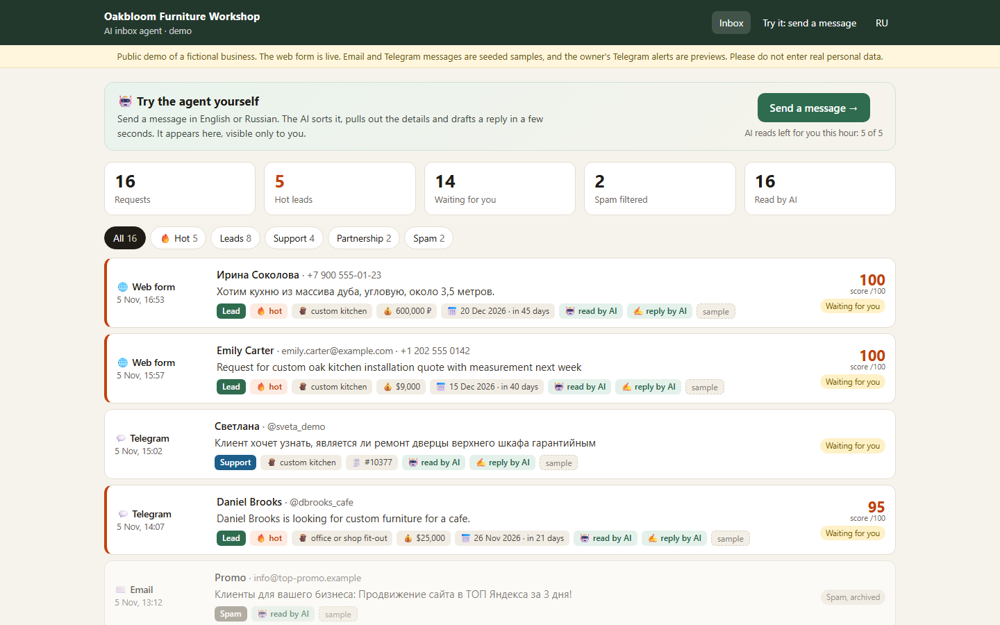
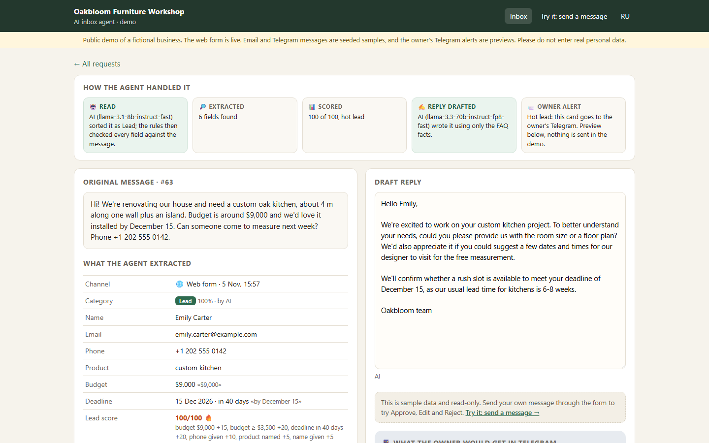
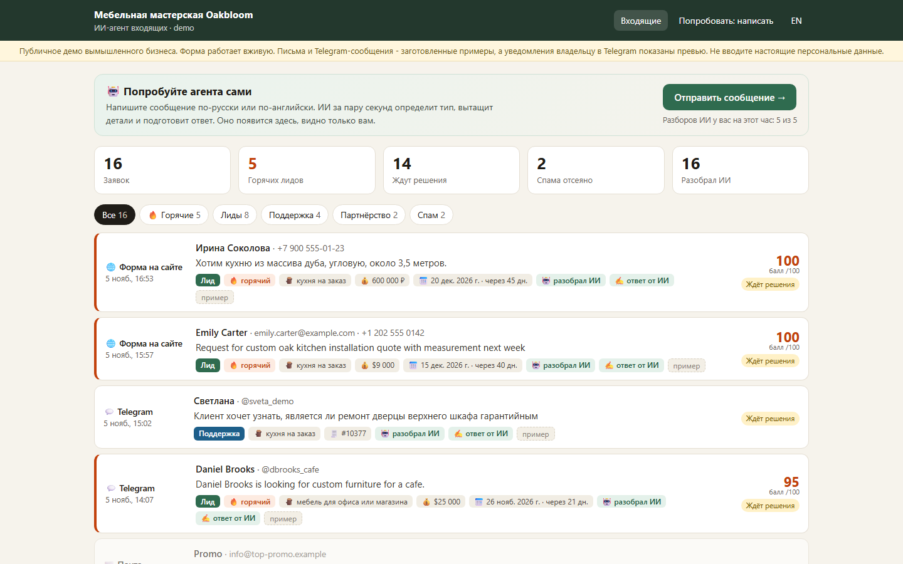
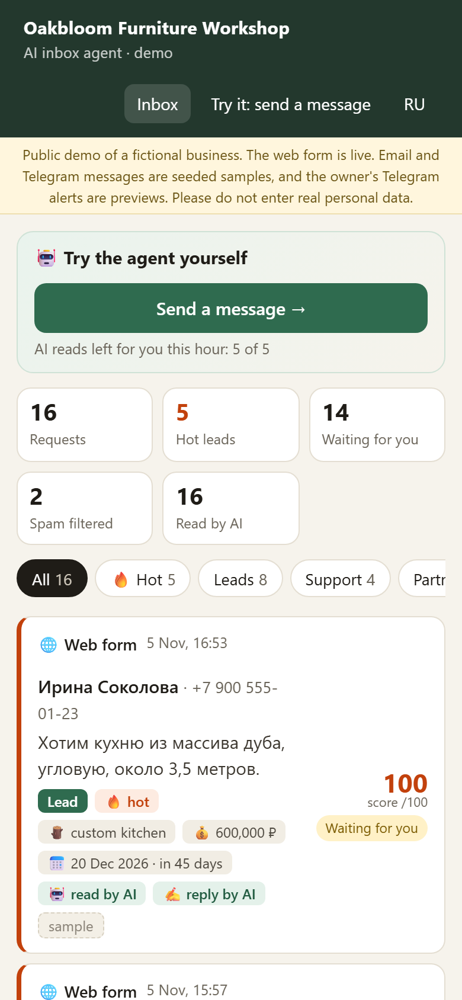
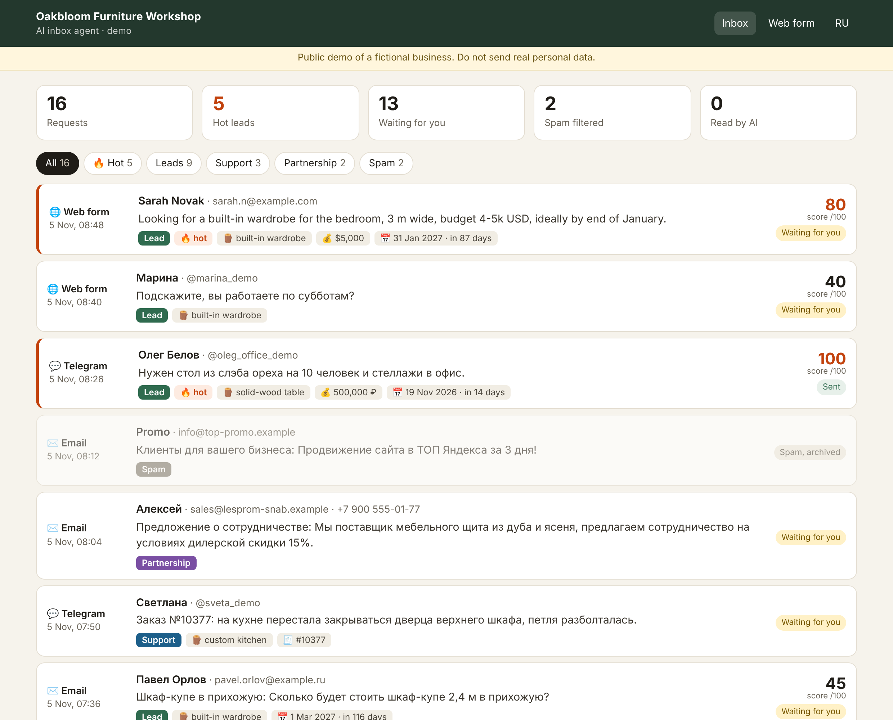
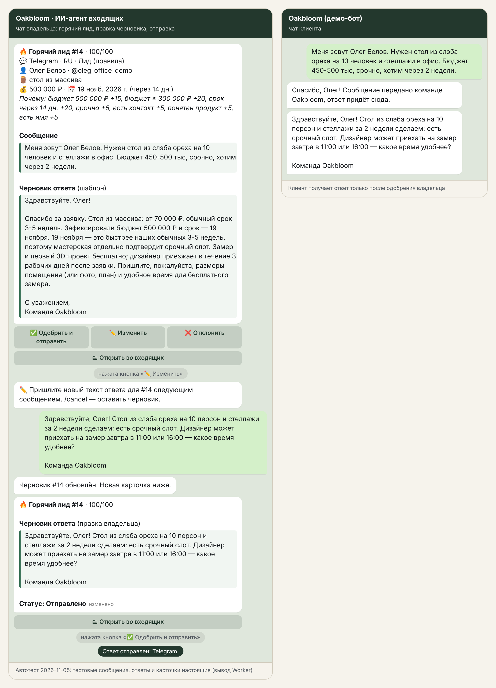
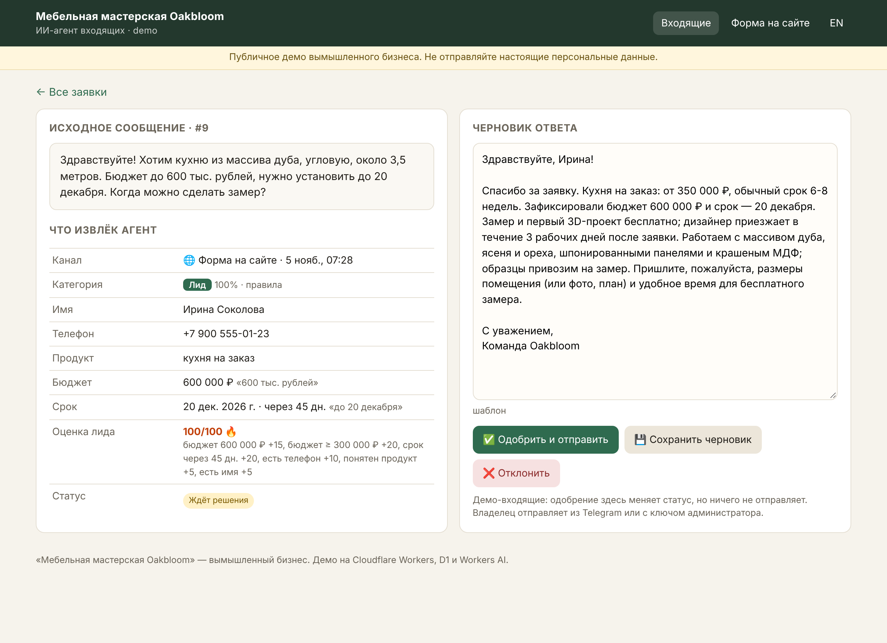

# AI inbox agent (demo)

An AI agent for a small business inbox. Requests arrive from a **web form**, an **email-style JSON webhook** (or
Cloudflare Email Routing) and a **Telegram bot**. For each one the agent:

1. sorts it into **lead / support / spam / partnership**,
2. extracts **name, contact (email, phone, @username), budget, deadline**, plus the product and an order number,
3. drafts a reply **from the business FAQ only**,
4. gives each lead a **0-100 score** and explains it line by line,
5. sends **hot leads** to the owner's Telegram as a card with **✅ Approve / ✏️ Edit / ❌ Reject**,
6. lists everything in a small **web inbox**, where drafts can also be edited and approved.

Nothing is sent to a customer until the owner approves the draft.

The business is **fictional**: "Oakbloom Furniture Workshop", a custom-furniture workshop (`data/business.js`).
Stack: Cloudflare Worker + D1 + Workers AI (`@cf/meta/llama-3.1-8b-instruct-fast` reads, `@cf/meta/llama-3.3-70b-instruct-fp8-fast` writes the reply). It all runs on the free plan
and needs no paid API keys. Every step has a rule-based fallback, so the agent keeps working when the AI is down or over
its daily cap, and the tests run fully offline.

## The public demo

Live at `https://ai-inbox-agent-demo.sherlock753cc.workers.dev/inbox` (RU/EN switch in the header). It opens without a key.

- **The AI path is visible.** Every row says which path produced it: `read by AI` or `read by rules`, and `reply by AI`
  or `reply from template`. A request's page shows the agent's steps (read, extracted, scored, drafted, owner alert),
  which model did what, and why a message fell back to the rules when it did.
- **The 16 sample messages are real model output.** `scripts/seed.mjs` posts them to `POST /api/seed` (needs
  `INBOX_SECRET`), and the Worker runs the same AI path on them as on any visitor message. Nothing is hand-written. They
  are marked `sample` and are read-only.
- **A visitor can send their own message** in the form. They see it classified, the details extracted and a reply
  drafted within a few seconds, and it shows up only in their own inbox (a random cookie, kept 24 hours). Approve, edit
  and reject work on their own messages but send nothing.
- **Caps (Workers AI is a shared free budget).** One AI read = one message (classify + draft). Per visitor IP:
  `AI_IP_HOURLY` = 5 per hour. Whole demo: `AI_DAILY_CAP` = 80 per day. Past a cap the message is still handled by the
  rules and templates, with a visible note ("AI daily demo limit reached, showing the rule-based result."). Counters live
  in D1 (`demo_rate`), updated atomically; only a hash of the IP is stored. Form submissions are capped too
  (`SUBMIT_HOURLY` = 20 per IP per hour).
- **Models.** `@cf/meta/llama-3.1-8b-instruct-fast` reads the message (valid JSON on 16 of 16 samples when measured; the
  server still repairs and validates the JSON and checks every field against the message). `@cf/meta/llama-3.3-70b-instruct-fp8-fast`
  writes the reply, because its Russian is clearly better.
- **Email and Telegram are shown as samples.** No mailbox is read and no bot is connected. `TG_WEBHOOK = "closed"` keeps
  the Telegram webhook shut, and a hot lead's page shows the card the owner would get as a preview.
- **No cron.** Nothing here is scheduled, so no trigger is used. Visitor messages older than a day are deleted lazily on
  the next form submission.
- **Owner view.** `/inbox?key=<ADMIN_KEY>` shows every message and really sends approved replies.

| Inbox | One request: the agent's steps | RU | Mobile |
|---|---|---|---|
|  |  |  |  |

`node scripts/live-shots.mjs <url> <dir>` renders these from the live Worker.

## Original screenshots (rules + templates only, no AI binding)

| Web inbox | Owner's Telegram (hot lead → edit → approve) | One request |
|---|---|---|
|  |  |  |

These come from an in-process run of the Worker over the 16 sample messages (`npm run shots`) with no AI binding, so
they show the rules + templates fallback. The live demo above uses the model.

## How it works

```
web form ─┐
email  ───┼─> channels.js ─> classify.js ──> score.js ─> draft.js ──> D1 ──> hot? ─> owner card in Telegram
Telegram ─┘   (one shape)    AI JSON + rules   rules     AI or FAQ          │        ✅ send · ✏️ edit · ❌ reject
                             (rules check AI)            template           └─> web inbox (/inbox)
```

- **Classification.** Workers AI returns JSON: category, name, contact, budget, deadline and a one-line summary. The
  rules always run as well. A contact or name the model "found" is kept only if it really appears in the message.
  Budget and deadline are re-parsed into numbers and dates. If the AI is missing, fails, returns garbage or passes
  `AI_DAILY_CAP`, the weighted keyword rules decide (RU and EN stems, link count, caps, order numbers).
- **Extraction (rules).** Handles `$9,000`, `4-5k USD`, `600 тыс. рублей`, `от 200 до 300 тыс`, `1,2 млн`, and does not
  take phone numbers, `4 m` or `2,4 м` for money. Deadlines: `by December 15`, `до 20 декабря`, `к 25-му декабря`,
  `in 3 weeks`, `через пару недель`, `к Новому году`, `end of January`, `15.01.2027`, `срочно`/`ASAP`.
- **Lead score.** A lead starts at 25. Then: budget given +15, budget at or above the threshold (300 000 ₽ / $3 500 / €3 200)
  +20, deadline within 45 days +20 (any deadline +5), urgent +5, phone +10 (other contact +5), product named +5, name
  +5. **70 or more is hot.** You can change the thresholds in `data/business.js`. The card shows the reasons, e.g.
  `budget 500 000 ₽ +15, budget ≥ 300 000 ₽ +20, deadline in 14 days +20…`.
- **Drafts.** The model gets only the FAQ facts that fit the request and is told not to invent prices, dates or
  promises. The fallback template uses the same facts. It greets by first name, quotes the product price and lead time,
  restates the budget and deadline, warns when the deadline is shorter than the usual lead time, and asks for the
  next step. Spam gets no draft and no notification.
- **Approve.** A Telegram request gets its reply right in the customer's chat. An email or form request becomes
  "approved, ready to send". The inbox has a one-click "Reply in your mail app" button with the text filled in. To send
  it automatically, set `REPLY_WEBHOOK_URL`: the Worker POSTs `{to, subject, text}` there (your mail service, CRM, Make or
  n8n).
- **Edit.** ✏️ asks the owner for the new text. The owner's next message replaces the draft, and a fresh card comes
  back with the buttons. `/cancel` keeps the old draft.

## Deploy (one command)

Needs Node 22.5+ and a Cloudflare account logged in with `npx wrangler login`.

1. Optional, for Telegram: create a bot in **@BotFather** and paste its token into `bot-token.txt` in this folder
   (one line, git-ignored). Open the bot and press **Start** once, so the script can read your chat id.
2. Run:

```bash
cd demos/ai-inbox-agent && npm install && node scripts/deploy.mjs --seed
```

The script creates the D1 database the first time and writes its id into `wrangler.toml`. If wrangler offers to edit
the config, answer **No**. Then it applies the migration (answer **Yes**), deploys the Worker and stores the secrets.
Those are a random `ADMIN_KEY`, `INBOX_SECRET` and `WEBHOOK_SECRET` (saved to the git-ignored `deploy-secrets.txt`),
plus `BOT_TOKEN` and `OWNER_CHAT_ID` when a token is given. It also sets the Telegram webhook and, with `--seed`, posts
the RU/EN sample messages. At the end it prints the inbox, form and webhook URLs. `--dry` only prints the steps.
`--owner <chat id>` sets the owner if the script cannot find it.

Later code changes need only:

```bash
npx wrangler deploy
```

## Run and test locally

```bash
npm install
npm test
```

`npm test` runs 42 offline checks with Node's built-in test runner. It needs no network, no wrangler and no AI. The
Worker runs in-process against a D1 shim over Node's built-in SQLite, using the real migrations, and every Telegram
call is recorded instead of sent. The tests cover:

- all 16 samples (RU and EN, every category, all three channels);
- the parsers;
- raw MIME email parsing;
- owner cards and approve, edit and reject in Telegram, including an outsider pressing the buttons;
- the web inbox and its access rules;
- the email-webhook secret, duplicate Message-IDs and the reply webhook;
- the AI path with a fake model: kept output, dropped invented contacts, and fallback on error, garbage, caps and `AI_MODE=off`;
- JSON repair, the per-IP and daily caps, the public view (samples plus the visitor's own messages only) and the closed Telegram webhook.

To try it in the real Workers runtime:

```bash
npm run db:local
```

```bash
npm run dev
```

Then, in a second terminal:

```bash
npm run seed
```

Open `http://127.0.0.1:18798/inbox`. Without `BOT_TOKEN`, the Telegram calls come back in the JSON responses. The
Workers AI binding is remote, so local dev uses your login and a little of the free allowance. To run on rules only,
add `--var AI_MODE:off`.

`npm run shots` re-renders the original `shots/*.png` from an in-process run (needs Playwright with Chromium; not re-run after the public-demo changes, so check its output).

## Endpoints

| | |
|---|---|
| `GET /inbox`, `/inbox/:id` | Web inbox. Public while `DEMO_MODE = "on"`; otherwise open `/inbox?key=<ADMIN_KEY>` once and a cookie keeps the key |
| `POST /inbox/:id` | `action=approve\|save\|reject`, `draft=...`. In the public demo a visitor can act on their own messages only (sample data is read-only), and approval only changes the status; sending needs the key |
| `GET/POST /form`, `POST /api/form` | Public request form (HTML / JSON `{name, contact, message}`), with a honeypot field and the per-IP caps |
| `POST /api/seed` | `{channel: form\|email\|telegram, ..., ago_min}` + header `X-Inbox-Secret`. Sample data for the public demo, read by the AI without the visitor caps |
| `POST /api/email` | `{from: "Name <addr>", subject, text, message_id?}` + header `X-Inbox-Secret`. Duplicates are dropped by `message_id` |
| `email()` handler | Cloudflare Email Routing: forward `info@your-domain` to this Worker, and the raw MIME is parsed (text or HTML part, base64 or quoted-printable) |
| `POST /telegram` | Telegram webhook (checks the secret header): customers write in, the owner presses buttons, `/inbox` gives a summary |
| `GET /api/requests` | JSON list with stats |

## Settings (`wrangler.toml` `[vars]`)

| Var | Default | |
|---|---|---|
| `DEMO_MODE` | `on` | Public inbox and a demo banner. Telegram visitors also get a copy of the owner card and may press its buttons for their own request. Set it to `off` for a real client |
| `OWNER_LANG` | `ru` | Language of the owner's cards |
| `NOTIFY` | `hot` | `all` = every request except spam goes to Telegram |
| `AI_MODEL`, `AI_DRAFT_MODEL` | llama-3.1-8b-instruct-fast, llama-3.3-70b-instruct-fp8-fast | Model that reads the message, and model that writes the reply |
| `AI_DAILY_CAP`, `AI_IP_HOURLY`, `SUBMIT_HOURLY` | `80`, `5`, `20` | AI-read messages per day (whole demo), AI-read messages per visitor IP per hour, form submissions per IP per hour. Past an AI cap the rules and templates take over, with a visible note |
| `AI_MODE` | `on` | `off`: rules only, no AI calls at all |
| `TG_WEBHOOK` | `closed` | With no `BOT_TOKEN`, keep `/telegram` closed (the public demo) |

The secrets are listed in `wrangler.toml` and set by the deploy script.

## Reuse for a client

1. Replace `data/business.js`: name, products with price and lead time, FAQ facts, hot-lead thresholds.
2. Add the client's own keywords to `SIGNALS` in `src/classify.js` if their spam or partners look different.
3. Set `DEMO_MODE = "off"` and deploy.
4. Point their site form at `/api/form`, their mailbox at `/api/email` or Email Routing, and set `REPLY_WEBHOOK_URL`
   if email replies should go out automatically.

## Limits worth knowing

- The free Workers AI allowance is about 10,000 "neurons" a day per account (Cloudflare docs, not re-checked here).
  `AI_DAILY_CAP` and `AI_IP_HOURLY` stay well under it, and past a cap the rules keep answering.
- Cloudflare Workers cannot send email to arbitrary addresses for free. Approved email and form replies therefore go
  out from your mail app (one click) or through `REPLY_WEBHOOK_URL`.
- The rules are tuned to this business's vocabulary. A new business needs its own keywords in `SIGNALS` and its own FAQ.

---

## Для заказчика (RU)

**ИИ-агент для входящих заявок.** Он собирает обращения с сайта, из почты и из Telegram в одно место. Каждую заявку
агент сам сортирует, вытаскивает из неё нужные данные и готовит ответ. Горячих клиентов он сразу присылает вам в
Telegram.

Что делает агент:

- **Сортирует** каждое сообщение: новый клиент (лид), вопрос по заказу (поддержка), предложение о сотрудничестве или
  спам. Спам уходит в архив и вас не беспокоит.
- **Достаёт данные**: имя, телефон, почту, @username, бюджет («до 600 тыс.», «4-5k USD»), срок («до 20 декабря»,
  «через 2 недели», «к Новому году»), что именно хочет клиент и номер заказа.
- **Пишет черновик ответа** по вашему FAQ: цены, сроки, условия. Агент не придумывает того, чего нет в ваших данных.
- **Оценивает лида по 100-балльной шкале** и показывает, за что баллы: бюджет, срочность, есть ли телефон. Горячий лид
  приходит вам в Telegram карточкой с кнопками **«Одобрить и отправить» / «Изменить» / «Отклонить»**. Клиенту уходит
  только то, что вы одобрили.
- **Веб-кабинет «Входящие»**: все заявки с фильтрами (горячие, лиды, поддержка, партнёрство, спам), карточка заявки и
  редактор ответа.
- **Работает без платных сервисов**: Cloudflare (бесплатный тариф) и встроенный ИИ Cloudflare. Если ИИ недоступен,
  агент переключается на правила и шаблоны и не теряет ни одной заявки.

Что нужно от вас для запуска:

- список услуг или товаров с ценами и сроками и 10-20 частых вопросов с ответами;
- ваш порог «горячего» клиента (бюджет, срок);
- куда приходят заявки: форма на сайте, почта, Telegram.

Что можно добавить: запись заявок в amoCRM, Bitrix24 или Google Таблицы; автоматическую отправку писем через вашу
почту; WhatsApp и MAX; ежедневную сводку владельцу.

Демо сделано для вымышленной мастерской Oakbloom; все имена, телефоны и адреса в примерах придуманы.
