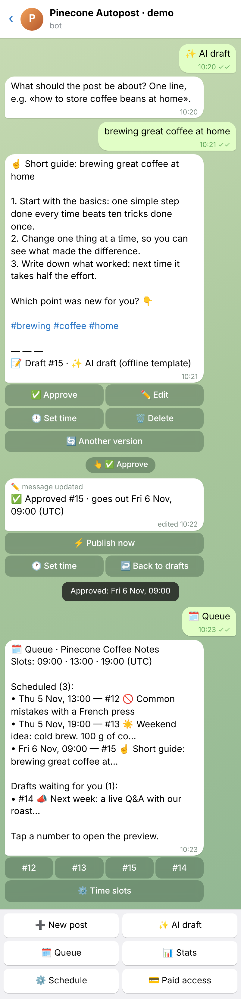
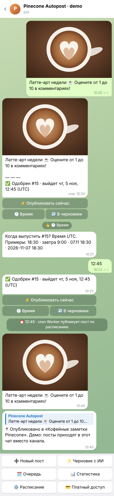
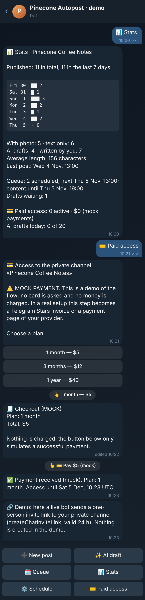

# Telegram autoposting bot for a channel owner

A bot that runs a Telegram channel for its owner. You add posts by sending them to the bot (text, or a photo with a
caption), or you ask for an **AI draft** from a topic. Each post comes back as a **preview with Approve / Edit
buttons**, and approved posts **go out by themselves** at the channel's time slots. The bot also shows **stats** of
what was published and includes a **paid-access skeleton** for a private channel: a plan, a mock payment and a
one-person invite link.

> **The payment is a mock.** No card is asked for and no money is charged (`provider = 'mock'` in the database). The
> rest of the paid-access flow is real: the payment record, the subscription, the invite link, the reminder and the
> removal at expiry. [Making it take real money](#real-payments) is a small change.

The demo channel, **Pinecone Coffee Notes**, is fictional, and so is every post in it.

Runs free on Cloudflare: one Worker (webhook + a Cron Trigger every 5 minutes), D1 for data, Workers AI for drafts
(`@cf/meta/llama-3.3-70b-instruct-fp8-fast`, free daily allowance, no API key). No build step, no framework, and
wrangler is the only dependency.

| AI draft → Approve → queue | Photo post, time, autopublish (RU) | Stats and paid access (dark) |
|---|---|---|
|  |  |  |

The screenshots are HTML mocks of real bot output. `npm run shots` runs three conversations through the real Worker
code offline, takes every Telegram call the bot made (messages, edits, buttons), and draws them as a Telegram-style
chat in headless Chromium. Only the chat styling and the latte photo are mocked; every text and button comes from the
bot. Offline there is no Workers AI, so the AI draft in shot 1 comes from the offline template, and its preview says
so. The same conversations as text are in [`test/transcript.md`](test/transcript.md).

## What it does

**Content queue**
- Send the bot any text or a photo with a caption, and it becomes a draft. Formatting (bold, links, etc.) is kept and
  published as it was sent. Forwarded posts work too.
- 🗓 **Queue** lists scheduled posts by time and the drafts waiting for review. Tap a number to open a post's preview.

**AI drafts**
- ✨ **AI draft** (or `/draft <topic>`): Workers AI writes a post for the channel in the owner's language, with a hook,
  short body, a question to readers and hashtags. The prompt bans invented numbers, prices and links. Output is cleaned
  to plain text and capped at 900 characters, so it still fits a photo caption.
- 🔄 **Another version** writes a new variant of the same topic.
- **Fallback:** without the AI binding, when the daily limit is reached (`AI_DAILY_LIMIT`, default 20 per channel), or
  when the model fails, a rule-based template writes the draft, so the button always works. The preview says which
  engine wrote it.

**Preview and approval**
- Every draft comes back exactly as it will look in the channel, plus one status line: `📝 Draft #15 · ✨ AI draft`.
- Buttons: ✅ Approve · ✏️ Edit · 🕐 Set time · 🗑 Delete (and 🔄 Another version for AI drafts).
- **Approve** puts the post into the next free slot, one post per slot. **Set time** takes a typed time:
  `18:30`, `tomorrow 9:00`, `07.11 18:30` or `2026-11-07 18:30`.
- **Edit** takes the new text or photo. The old preview is marked as replaced, so its buttons can't act on content
  it no longer shows.
- An approved post has ⚡ Publish now · 🕐 Set time · ↩️ Back to drafts.

**Schedule and publishing**
- ⚙️ **Schedule**: one-tap presets (1, 2 or 3 posts a day) or your own times with `/slots 08:30 12:00 20:00`.
  Set the channel's UTC offset with `/tz +2`.
- A Cron Trigger runs every 5 minutes and publishes whatever is due, in time order. Each post is claimed atomically
  first, so a cron run and a "Publish now" press can't send the same post twice.
- **If Telegram refuses** (for example the bot is not an admin of the channel), the post is marked failed and the
  owner gets the reason and a hint. ⚡ Try again re-sends it. Failed posts are never retried blindly.
- If the Worker dies mid-send, a post stuck in "publishing" is released as failed after 10 minutes and is not sent
  again.

**Stats** (📊)
- Published in total and in the last 7 days, with a per-day bar chart.
- With photo vs text only, AI drafts vs your own posts, and the average length.
- When the last post went out and when the next one goes out.
- How far the queue lasts, drafts waiting, and failed posts.
- Active subscribers and payments received (mock), and AI drafts used today.

**Paid access** (💳, skeleton with a mock payment)
- Choose a plan (1 month, 3 months, 1 year; USD, EUR or RUB) → checkout → **"Pay (mock)"** → a payment record → the
  subscription is created or extended from its current end date.
- **Live mode:** the bot creates a **one-person invite link** to the private channel (`createChatInviteLink`, valid
  for 24 hours) and sends it with a Join button. The owners are notified.
- **Reminders and expiry:** a reminder goes out 3 days before the end. At the end the member is removed from the
  channel (ban + immediate unban, so they can rejoin after paying again) and offered a renewal.
- The payment can only be confirmed by the payer, and only once, so a double tap doesn't extend access twice.

Everything is in English and Russian. The language comes from the Telegram client, and `/lang` switches it.

## Two modes

- **Demo (`DEMO_MODE = "on"`, default):** every visitor owns a private sandbox: the fictional coffee channel with a
  week of published history, two scheduled posts and a draft. "Published" posts come back to the visitor's own chat,
  marked as such, instead of going to a channel. The paid-access flow shows where the invite link would be and has a
  "simulate the end of access" button. Sandbox subscriptions lapse quietly, so a visitor gets no reminder a month
  later. `/reset` starts over.
- **Live (`DEMO_MODE = "off"`):** one real channel. Only the people in `OWNER_IDS` manage it. Everyone else sees
  only 💳 Subscribe and 🎫 My access.

## Deploy (one command)

Needs Node 22.13+ and a free Cloudflare account. First create a bot in [@BotFather](https://t.me/BotFather) and paste
its token into `bot-token.txt` in this folder (git-ignored). Then:

```bash
cd demos/channel-autopost-bot && npm install && npm run deploy
```

On the first run, wrangler opens a browser to log in to Cloudflare. The script:
1. Creates the D1 database and writes its id into `wrangler.toml`. If wrangler offers to edit the config itself,
   answer No.
2. Applies the migration (answer Yes if asked).
3. Deploys the Worker with the cron and the Workers AI binding.
4. Stores the `BOT_TOKEN` and a random `WEBHOOK_SECRET` as secrets.
5. Sets the webhook with that secret, the commands and the bot descriptions in EN and RU.

`npm run deploy -- --dry` prints every step without changing anything. After a code change, redeploy with:

```bash
npx wrangler deploy
```

### Going live on a real channel

1. Add the bot to the channel as an **admin** with the **Post messages** right.
2. In `wrangler.toml`, set:
   - `DEMO_MODE = "off"`
   - `OWNER_IDS = "<your Telegram id>"` (send `/id` to the bot to get it)
   - `CHANNEL_ID = "@your_channel"` (or the `-100…` id of a private channel)
   - `CHANNEL_TITLE`, and `DEFAULT_SLOTS` / `TZ_OFFSET` if needed
3. For paid access, add the bot to the private channel as an admin with **Invite users via link** and **Ban users**,
   and set `PAID_CHANNEL_ID = "-100…"`. `CURRENCY` is `USD`, `EUR` or `RUB`. Plan prices are in `src/paywall.js`.
   Put `https://t.me/<your_bot>?start=subscribe` in your public channel: it opens the plans directly.
4. `npx wrangler deploy`.

Later, `/title`, `/channel`, `/slots` and `/tz` change these from the bot itself.

### Real payments

The mock sits in one place: `mockPay()` in `src/paywall.js` marks the payment paid, then calls `confirmPayment()`.
Everything after that is provider-independent. To take real money:
- **Telegram Stars** (no payment provider, no keys): replace the "Pay (mock)" button with `sendInvoice` (currency
  `XTR`), answer `pre_checkout_query`, and on `successful_payment` call `confirmPayment()`.
- **A card provider** (YooKassa, Stripe, etc.): send the provider's payment link and call `confirmPayment()` from the
  provider's webhook after checking its signature. These need the provider's own account and keys.

## Run and test locally (no Cloudflare, no Telegram)

```bash
npm test
```

31 offline tests (Node's built-in test runner, about 0.3 s). They run the real Worker code against an in-memory
SQLite database that implements the D1 API (`scripts/d1-sqlite.mjs`). Telegram calls are captured instead of sent, so
nothing needs to be installed. They cover:
- **Webhook:** the secret, bad JSON, wrong method.
- **Posts:** text and photo posts with their formatting; previews and every button; slot assignment; typed times;
  edits; delete; the queue view; schedule presets, `/slots` and `/tz`; stats numbers.
- **Publishing:** the cron publishes once and in order; demo vs live targets; `/channel`; a failure, the owner
  notice and the retry; "Publish now" double press; stuck posts.
- **Workers AI:** the prompt, the output cleanup, all four fallback cases and the daily limit.
- **Paid access:** the mock wording; checkout, pay and the double tap; renewal from the end date; cancel; the invite
  link, owner notice, reminder and removal at expiry; the missing channel id; demo simulation and quiet lapse.
- **Access and parsing:** live-mode permissions; isolation between sandboxes; time and slot parsing.

```bash
npm run dev
```

Runs the Worker on `wrangler dev` with a local D1. First apply the migrations with
`npx wrangler d1 migrations apply channel-autopost-bot --local`, and put `WEBHOOK_SECRET` (and `BOT_TOKEN` to really
send) in `.dev.vars`. `curl "localhost:8787/__scheduled?cron=*/5+*+*+*+*"` fires the cron. Note that Workers AI calls
are remote even in local dev.

`npm run transcript` rewrites `test/transcript.md`. `npm run shots` re-renders the screenshots and needs Playwright
with Chromium.

## Limits worth knowing

- The Bot API does not report view counts of channel posts, so stats cover what the bot knows: what was published,
  when, of what kind, and the queue. Reaction counts can be added: a bot that is a channel admin can receive
  `message_reaction_count` updates. Views would need the MTProto API (a user account), which is out of scope here.
- Text and single photos only. Albums, video, documents and polls are small additions to `contentOf()` and
  `publishPost()`.
- Posts go out up to 5 minutes after their time (the cron interval). `*/1` works too, but uses more of the free
  Workers request allowance.
- Workers AI free allowance: 10,000 neurons a day per account (Cloudflare docs; not re-checked for this demo). One
  draft is a few hundred tokens, and past the allowance or `AI_DAILY_LIMIT` the offline template answers.
- Demo sandboxes are not cleaned up automatically. They are a few dozen small rows per visitor.

## Files

| Path | What |
|---|---|
| `src/worker.js` | Entry: `/webhook` (secret-checked), `/health`, `scheduled()` cron |
| `src/bot.js` | Updates, previews and buttons, queue/schedule/stats views, publishing, cron |
| `src/store.js` | D1 queries: users, settings, posts, slot assignment, stats, demo sandbox |
| `src/ai.js` | Workers AI drafts, output cleanup, offline template |
| `src/paywall.js` | Plans, mock checkout, `confirmPayment()`, invite links, reminders and expiry |
| `src/time.js` | Slots, UTC offsets, typed times, date formatting (no Intl dependency) |
| `src/i18n.js` | Every user-facing text in EN and RU |
| `src/seed.js` | Fictional demo channel content |
| `migrations/0001_init.sql` | D1 schema |
| `scripts/deploy.mjs` | One-command deploy and Telegram setup |
| `scripts/d1-sqlite.mjs` | D1 stand-in on `node:sqlite` for tests and screenshots |
| `scripts/scenarios.mjs`, `render-chat.mjs`, `shots.mjs`, `transcript.mjs` | Screenshot and transcript generation |
| `test/` | Offline tests and the transcript |

---

## По-русски: для заказчика

**Бот, который ведёт ваш Telegram-канал.** Вы присылаете боту пост (текст или фото с подписью) или просите
**черновик у ИИ** по теме. Бот показывает **превью** поста ровно так, как он будет выглядеть в канале, с кнопками
**«Одобрить» / «Изменить»**. Одобренные посты **выходят сами** по расписанию. Плюс **статистика** публикаций и
**продажа доступа в закрытый канал**.

Что есть в демо:
- **Очередь контента.** Любой текст или фото, присланные боту, становятся черновиком. Форматирование, ссылки и эмодзи
  сохраняются. В «🗓 Очереди» видно, что и когда выйдет и какие черновики ждут проверки.
- **Черновики с ИИ.** Укажите тему, и нейросеть (Workers AI от Cloudflare, без платных ключей) напишет пост в стиле
  канала: цепляющее начало, суть, вопрос к читателям, хэштеги. Кнопка «🔄 Другой вариант» перепишет текст. Если ИИ
  недоступен или дневной лимит исчерпан, черновик пишет встроенный шаблон, и бот не замолкает.
- **Превью и одобрение.** Кнопки: ✅ Одобрить, ✏️ Изменить, 🕐 Время, 🗑 Удалить. Одобренный пост встаёт в ближайший
  свободный слот. Можно задать точное время, например «завтра 9:00» или «07.11 18:30», или опубликовать сразу.
- **Расписание.** Готовые варианты «1, 2 или 3 поста в день» или свои слоты, плюс часовой пояс канала. Публикует
  планировщик Cloudflare (cron) каждые 5 минут. Пост не уйдёт дважды. Если Telegram отказал (например, бот не админ
  канала), бот сообщит причину, и пост можно отправить заново одной кнопкой.
- **Статистика.** Сколько опубликовано за всё время и за 7 дней (график по дням), доля постов с фото и постов от
  ИИ, средняя длина, на сколько дней хватит очереди, сколько черновиков ждут, подписчики и выручка платного доступа.
- **Платный доступ (каркас).** Тарифы, оформление, оплата, затем персональная ссылка-приглашение в закрытый канал
  (на одного человека, на 24 часа). За 3 дня до конца бот напоминает о продлении, после окончания исключает
  участника из канала. **В демо оплата — заглушка:** карта не запрашивается, деньги не списываются, это прямо
  написано в боте. Подключить настоящую оплату через Telegram Stars или вашу платёжную систему (ЮKassa и т. п.) —
  отдельный небольшой шаг: вся остальная логика уже готова.
- Русский и английский язык интерфейса.

Как попробовать: откройте бота и нажмите Start. Вам достанется своя песочница с вымышленным кофейным каналом
«Кофейные заметки Pinecone»: неделя истории, запланированные посты и черновик. В демо «опубликованные» посты приходят
вам в чат вместо канала. `/reset` начинает заново.

Что можно доработать под вас:
- несколько каналов и несколько редакторов с ролями: автор предлагает, редактор одобряет;
- альбомы, видео, опросы, кнопки под постами, отложенное удаление рекламных постов;
- кросспостинг в VK, MAX, другие каналы; импорт постов из Google Таблицы;
- генерация картинок к постам, рубрикатор и контент-план на неделю от ИИ;
- реальная оплата (Telegram Stars, ЮKassa, Stripe), промокоды, пробный период, выгрузка подписчиков.

Техника: Cloudflare Workers + D1 + Workers AI. На малых объёмах хостинг бесплатный, отдельный сервер не нужен,
разворачивается одной командой. Код остаётся у вас, с тестами и инструкцией.
