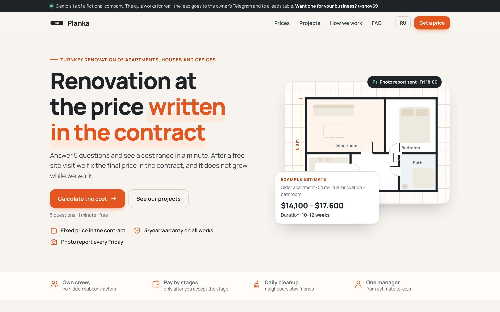
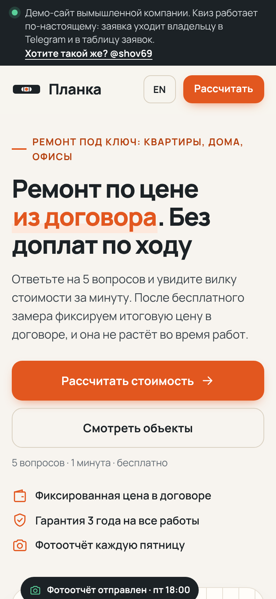
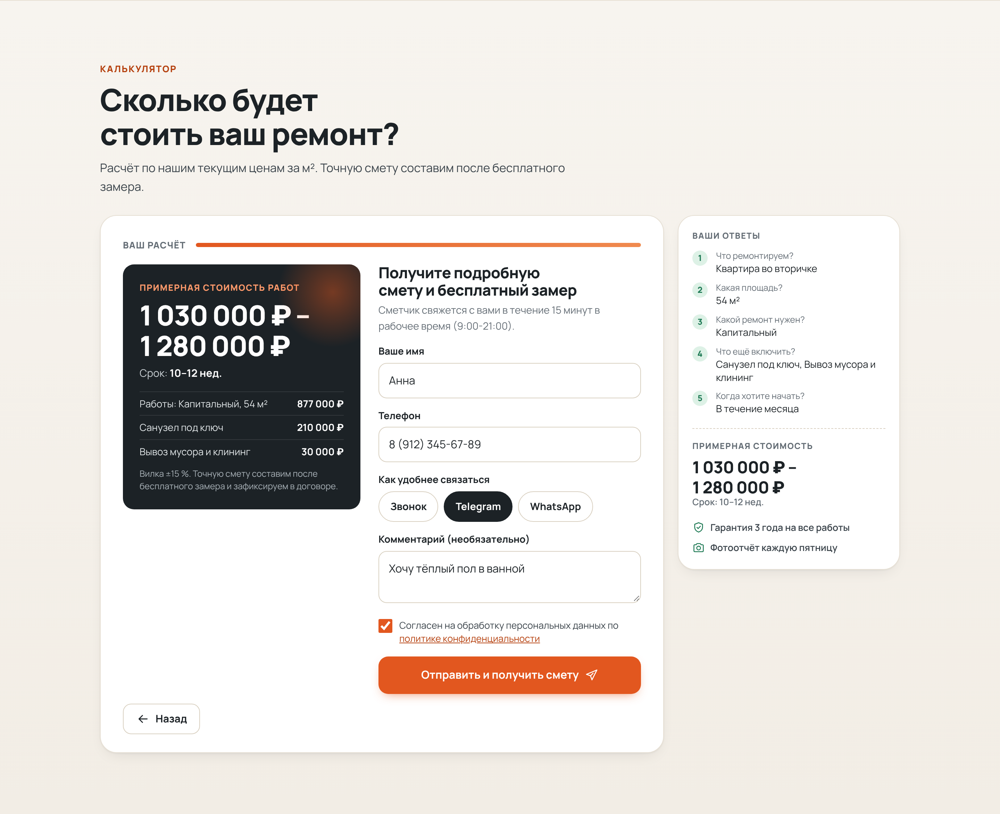

# Landing page + cost quiz → leads in Telegram (demo)

A fast landing page for **Planka**, a fictional renovation company, with a 5-step cost calculator. The visitor
answers 5 questions, sees a price range and duration, and leaves a phone number. A Cloudflare Worker checks the
lead, stores it in D1, and sends it to the owner's Telegram. The owner works the leads in a password-protected table
with statuses, notes and CSV export. English at `/`, Russian at `/ru/`. Everything runs on Cloudflare's free plan.

## Live demo

https://landing-quiz-demo.sherlock753cc.workers.dev/ (RU: `/ru/`). Built by Ilshat: https://ilshat-builds.sherlock753cc.workers.dev/

The live copy runs in **demo mode** (`DEMO_MODE = "1"` in `wrangler.toml`): there is no Telegram bot, so after the quiz is
sent the page shows the estimate and the exact card the owner would get in Telegram. Leads are still stored in D1.

- `POST /api/lead`: 5 leads per IP per hour (`RATE_LIMIT_PER_HOUR`) and a site-wide ceiling per rolling 24 hours (`DEMO_DAILY_CAP`), then HTTP 429.
- `/admin` (the real leads table) is behind `ADMIN_PASSWORD`. `/owner-demo` is a public read-only copy that shows only the made-up rows from `src/seed.js` and never reads the database.
- `node scripts/seed.mjs seed.sql` writes the SQL for the made-up rows; load it with `npx wrangler d1 execute landing-quiz-demo --remote --file seed.sql`.
- The Worker runs first for `/api/*`, `/admin*` and `/owner-demo` (`run_worker_first`); without it a browser navigation to those paths gets the static 404 page.

| Desktop (EN) | Mobile (RU) |
|---|---|
|  |  |



More from the same headless run: [the Telegram card the owner gets](review/telegram-card.png),
[the leads table](review/admin-1440.png) ([mobile](review/admin-375.png)), [the thank-you screen](review/done-1440.png),
and full pages at [375](review/page-ru-375.png) / [768](review/page-ru-768.png) / [1440](review/page-en-1440.png) px.

## Deploy (one command)

Needs Node 22.13+ and a Cloudflare login on this machine (`npx wrangler login`, once).

1. Optional, for lead cards in Telegram: create a bot in **@BotFather**, paste its token into
   `demos/landing-quiz/tg-token.txt` (one line, git-ignored), open the bot and press **Start** once.
   Without the token the site still works; leads appear only in the leads table.
2. Run:

```bash
cd demos/landing-quiz && npm install && npm run deploy
```

The script builds the pages, creates the D1 database on the first run (its id goes into `wrangler.toml`), applies the
migrations, runs `npx wrangler deploy`, and sets the secrets: `ADMIN_PASSWORD` (generated into `admin-password.txt`,
git-ignored), `IP_SALT`, `TG_BOT_TOKEN` and `TG_CHAT_ID`. Your chat id is read from the bot's updates, which is
why you press Start first. It prints the site, `/ru/` and `/admin` URLs. Two prompts can appear: when the
database is created, wrangler may offer to add it to the config (answer **No**, the script writes the id itself); the
migration asks to confirm (answer **Yes**).

- `npm run deploy -- --dry` prints every step and changes nothing.
- `npm run deploy -- --chat <id>` sets the chat id directly, for example a bot that already has a webhook, or a group.
- `npm run deploy -- --test-lead` sends one test lead through the live endpoint after the deploy.
- After a change to the code or copy, `npx wrangler deploy` is enough (run `npm run build` first if you edited copy or prices).

## Run it locally

```bash
cd demos/landing-quiz && npm test
```

29 offline tests (Node's built-in runner, no network, about 2.5 s). The tests run the real Worker code and the real
migrations, with `node:sqlite` standing in for D1 and Telegram replaced by a fake `fetch`. They cover:

- validation and error codes;
- the server-side estimate (a tampered price in the request is ignored);
- the Telegram card text and HTML escaping;
- retry on Telegram 5xx; a failed Telegram send never loses the lead;
- honeypot, rate limit, double-click dedupe, origin check / CORS;
- admin auth, lockout after 10 wrong passwords, CSRF guard, status updates, search;
- CSV export with protection against spreadsheet formulas;
- that the committed pages match the builder.

```bash
cd demos/landing-quiz && npm run serve
```

Opens a local copy at http://127.0.0.1:8788/ without Cloudflare (leads table at `/admin`, password `demo`). Telegram
cards are printed to the console. `npm run dev` does the same in the real Workers runtime (`wrangler dev`, local D1:
run `npm run db:local` once and copy `.dev.vars.example` to `.dev.vars`). `npm run shots` regenerates the screenshots and
checks every page at 375/768/1440 px (no horizontal scroll, no console errors).

## How it works

```
browser ── POST /api/lead (JSON) ──► Worker ── validate, recompute estimate, rate limit, dedupe
                                       │──► D1 `leads`                   (201 + lead number back to the page)
                                       └──► Telegram sendMessage         (after the response, 1 retry)
owner ──── GET /admin (password) ────► Worker ── table, filters, search, status + note, CSV
```

| Path | What |
|---|---|
| `public/js/quiz-model.js` | **Steps, options, prices and the estimate formula.** Shared by the browser, the Worker and the page builder |
| `src/site/content.mjs` | All page copy, EN and RU; `scripts/build.mjs` renders `public/index.html`, `public/ru/index.html` |
| `public/js/quiz.js`, `public/css/style.css` | Quiz controller and styles: no framework, about 25 KB gzipped with the HTML, plus 39 KB of fonts |
| `src/worker.js` | `POST /api/lead`, `/api/health`, routing; static files are served by Workers Static Assets |
| `src/lead.js` | Lead validation (name, phone normalisation, consent, UTM tags) |
| `src/telegram.js` | The owner's card and the Bot API call |
| `src/admin.js`, `src/i18n.js` | Leads table (HTTP Basic auth), CSV export; owner-facing texts |
| `migrations/*.sql` | D1 schema: `leads`, `auth_fails` |
| `scripts/deploy.mjs`, `scripts/serve-local.mjs`, `scripts/shots.mjs` | Deploy, local run, screenshots |

Settings in `wrangler.toml` `[vars]`: `OWNER_LANG` (`ru`/`en`, language of the card and the table),
`TIME_ZONE` (dates in the table), `RATE_LIMIT_PER_HOUR` (default 5 leads per IP), and `ALLOWED_ORIGINS` (other
sites allowed to post leads, to embed the quiz on an existing site).

Protection:

- every answer is checked against the quiz model and the price is recomputed on the server;
- hidden honeypot field; 8 KB body limit; browsers on other sites cannot post (Origin check);
- 5 leads per IP per hour; the IP itself is never stored, only a salted hash;
- all user text is escaped in Telegram and in the table;
- strict CSP on the landing page and the table;
- the table needs a password, locks an IP after 10 wrong passwords in 15 minutes, and refuses cross-site POSTs.

Free-plan limits (Cloudflare docs, not re-checked today): Workers 100,000 requests a day, D1 5 GB and 100,000
row writes a day. A lead costs one request and one write, plus one more write for the Telegram status.

## For buyers

**What you get:** a landing page that turns visitors into calls. The calculator gives a price range in a minute.
People leave their phone to get the itemised estimate. Every lead arrives in your Telegram within seconds, with the
answers, the estimate and the ad campaign it came from. All leads are also kept in a table where you mark progress
(new, contacted, site visit, contract, lost), add notes and download a CSV.

- Your services, prices and formula, in your words; any number of steps; RU and EN or one language.
- Your domain; hosting on Cloudflare's free plan, so no monthly fee for normal traffic.
- Fast on phones: no framework, no external scripts, about 65 KB over the network including fonts.
- Ready for ads: UTM tags reach the card and the table; with a tag manager on the page, every lead also pushes a `lead` event to `dataLayer`.
- What I need from you: services and prices, logo and colours, texts or a phone call to write them, and a Telegram bot token.

## Для заказчика

**Что вы получаете:** лендинг, который превращает посетителей в звонки. Калькулятор за минуту показывает вилку
цены. Чтобы получить подробную смету, человек оставляет телефон. Каждая заявка через несколько секунд приходит
вам в Telegram: ответы на вопросы, расчёт и рекламная кампания, из которой пришёл клиент. Все заявки хранятся в
таблице: статусы (новая, связались, замер, договор, отказ), заметки, выгрузка в CSV для Excel.

- Ваши услуги, цены и формула расчёта, ваши тексты; любое число шагов; русский и английский или один язык.
- Ваш домен; хостинг на бесплатном тарифе Cloudflare, без ежемесячной платы при обычном трафике.
- Быстро открывается с телефона: без фреймворков и внешних скриптов, около 65 КБ по сети вместе со шрифтами.
- Готово к рекламе: UTM-метки видны в карточке и в таблице; если на сайте стоит менеджер тегов, каждая заявка отправляет событие `lead` в `dataLayer`.
- Защита от спама и накруток: скрытое поле для ботов, лимит заявок с одного IP, повторное нажатие не создаёт дубль.
- Что нужно от вас: список услуг и цены, логотип и цвета, тексты (или созвон, чтобы написать их вместе), токен Telegram-бота.

Planka / «Планка» is a fictional company; the projects, prices and texts are examples for this demo.
