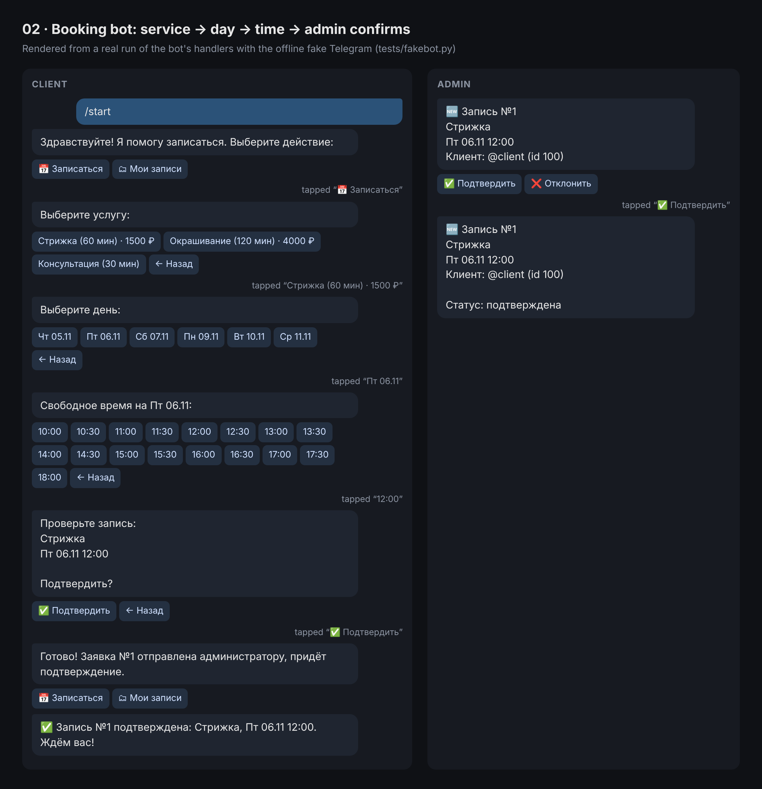
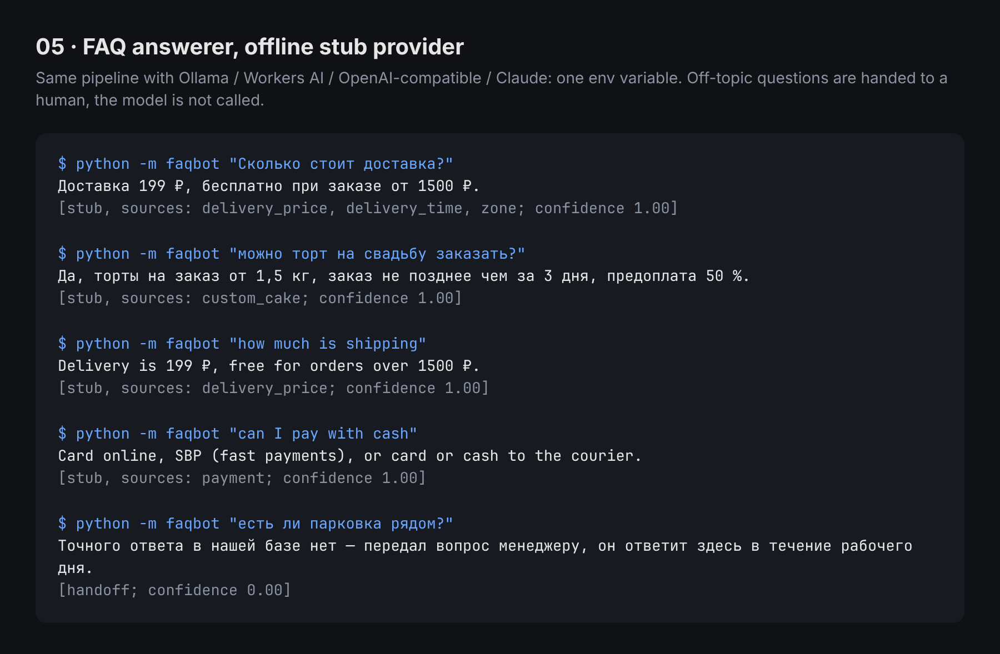

# Python automation starters · Заготовки для автоматизации на Python

**RU.** Пять самостоятельных заготовок под частые задачи автоматизации: Telegram-боты, вебхуки в CRM, парсинг, ИИ-ответы по FAQ.
У каждой README (что делает, запуск в 2 команды, как адаптировать за 30 минут), офлайн-тесты на pytest, RU/EN тексты.

**EN.** Five self-contained starters for common automation jobs: Telegram bots, webhooks into a CRM, scraping, LLM answers over
an FAQ. Each has a README (what it does, run in 2 commands, adapt in 30 minutes), offline pytest tests and RU/EN texts.

| # | Starter | Stack | Tests |
|---|---|---|---|
| 01 | [Telegram form → Google Sheets](01-tg-form-to-sheets/) | aiogram 3, gspread (service account) | 22 |
| 02 | [Telegram booking bot with admin confirmation](02-tg-booking-bot/) | aiogram 3, SQLite | 14 |
| 03 | [Webhook → CRM (amoCRM / Bitrix24)](03-webhook-to-crm/) | FastAPI, httpx | 27 |
| 04 | [Parser: pagination, retries, CSV / Sheets export](04-parser-export/) | httpx, BeautifulSoup, gspread | 21 |
| 05 | [LLM FAQ answerer, pluggable provider, offline stub](05-llm-faq/) | httpx, aiogram 3, optional anthropic | 34 |

| Booking bot (02), real handler output | FAQ answerer (05), real CLI output |
|---|---|
|  |  |

Screenshots are rebuilt from real runs: `python shots/build_shots.py && node shots/render.mjs`.

## Which starter? · Какую заготовку брать

| The request says (RU) | The request says (EN) | Start from |
|---|---|---|
| «Бот-анкета, ответы в Google Таблицу»; «бот для сбора заявок: имя, телефон → таблица»; «квиз-бот с записью результатов»; «бот регистрации на мероприятие»; «заявка из бота приходит менеджеру» | "Telegram bot that collects leads into Google Sheets"; "survey / questionnaire bot"; "registration bot writing to a spreadsheet" | **01** |
| «Бот для записи клиентов (салон, барбершоп, клиника)»; «онлайн-запись с выбором даты и времени кнопками»; «бронирование с уведомлением администратора»; «чтобы два клиента не записались на одно время» | "appointment / reservation bot"; "booking bot with inline calendar and time slots"; "admin gets notified and confirms" | **02** |
| «Интеграция Tilda ↔ amoCRM»; «заявки с сайта в Битрикс24»; «настроить вебхук: форма → CRM + уведомление в Telegram»; «передавать UTM-метки в сделку»; «без Make/Zapier» | "website form to CRM via webhook"; "Zapier-like integration in code"; "push leads to amoCRM / Bitrix24 / HubSpot" | **03** |
| «Спарсить каталог (название, цена, наличие) в Excel / Google Таблицу»; «парсер с пагинацией»; «мониторинг цен конкурентов»; «собрать данные с сайта в CSV» | "web scraper with pagination"; "scrape product listings to CSV / Google Sheets"; "price monitoring script" | **04** |
| «AI-бот отвечает клиентам по базе знаний / FAQ»; «бот с ChatGPT для поддержки»; «нейро-консультант: не знает — зовёт менеджера» | "AI customer-support chatbot on our FAQ"; "GPT-powered FAQ bot"; "RAG chatbot over a knowledge base" | **05** |
| «Бот записи + заявки в таблицу» | "Booking bot that also logs to Sheets" | **02** + writer from **01** |
| «Бот-квиз, лид в amoCRM» | "Quiz bot that creates a CRM lead" | **01** + client from **03** |
| «Парсер, который шлёт новые позиции в Telegram» | "Scraper with Telegram alerts" | **04** + `TelegramNotifier` from **03** |
| «AI-бот поддержки + запись» | "AI support bot that can also book" | **05** + **02** routers in one Dispatcher |

Not covered here: payment / paid-channel bots and MAX / VK bots. For payments,
02's README lists where `send_invoice` plugs in.

## Run everything

```bash
./run_tests.sh --install
```

Each starter also runs on its own: `cd 0X-… && pip install -r requirements-dev.txt && pytest`. Python 3.10+.
No tokens, accounts or network are needed for tests; Telegram, Google, CRMs and LLM APIs are replaced with
recording fakes (`tests/fakebot.py`, `httpx.MockTransport`, fake gspread clients).
