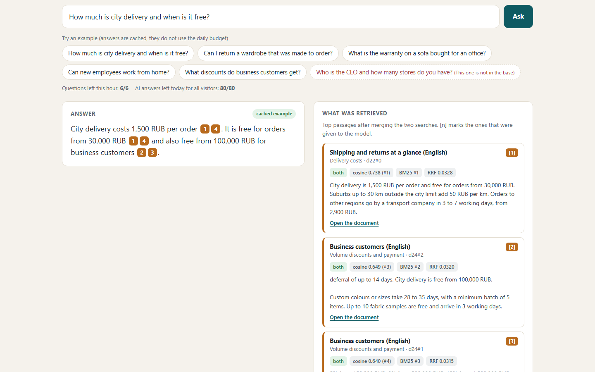
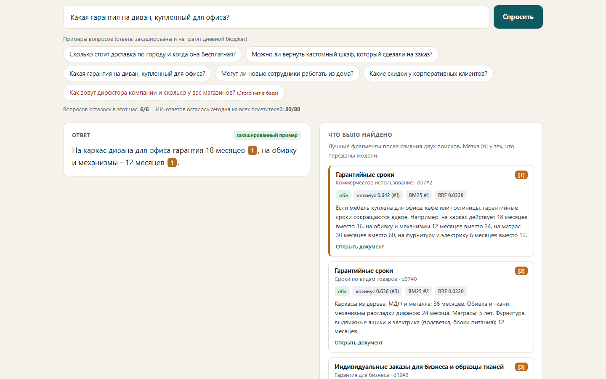
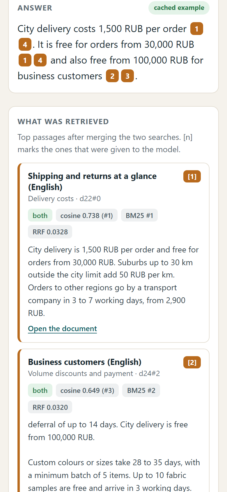

# RAG over a company knowledge base (demo)

Ask a question in Russian or English about a company knowledge base and get an answer with **numbered citations** to the
exact source passages. A panel next to the answer shows **what was retrieved**: the chunks, their document titles, their
scores, and which search found each one (**vector**, **full-text** or **both**). If the base does not contain the answer,
it says so plainly and does not invent one.

The company is **fictional**: "Harborline", an invented online furniture store. 25 short documents (21 in Russian, 4 in
English): delivery, returns, warranty, payment, B2B terms, staff onboarding, support scripts, loyalty, gift cards. All
numbers (days, fees, percentages) are made up and consistent across documents, so every citation can be checked in the
**Documents** tab.

Stack: Cloudflare Worker + **Workers AI** (embeddings `@cf/baai/bge-m3`, answers `@cf/meta/llama-3.3-70b-instruct-fp8-fast`)
+ **Vectorize** (vector index) + **D1 with FTS5** (full-text index). Free plan, no paid API keys.

| Question with citations and the retrieved panel | Russian UI | Mobile, 390 px |
|---|---|---|
|  |  |  |

Live demo: https://rag-knowledge-base-demo.sherlock753cc.workers.dev/

## How it works

```
documents ──> chunker ──> bge-m3 embeddings ──> Vectorize (1024-dim, cosine)          \
              (ingest script, run by the owner)  D1: docs, chunks, FTS5 index           |  at question time
                                                                                       |
question ──> embed ──> vector top 8 ──┐                                                |
        └──> BM25 full-text top 8 ────┴──> reciprocal rank fusion ──> top 6 chunks ────┘
                                                   │
                       best cosine < threshold? ───┴──> "В базе нет ответа на этот вопрос" (the model is not called)
                                                   │
                       top 4 chunks ──> prompt "use only these, cite [1], [2]" ──> answer + citations
```

- **Chunking** (`src/chunker.js`). A document is cut at its `##` headings first, then packed paragraph by paragraph up to
  330 characters (a longer paragraph is cut at sentence ends). Inside a section the next chunk starts 70 characters
  before the previous one ended, so a fact on a boundary is whole in at least one chunk. Chunks are slices of the
  original text with start/end offsets, which is how "Open the document" can highlight the exact passage. 25 documents
  become 78 chunks. The text that gets embedded is `title / heading + passage`.
- **Embeddings.** `@cf/baai/bge-m3` is multilingual: a Russian question finds an English passage and the other way
  round (the eval below has such a case). It returns 1024 numbers per text.
- **Vector search.** Cloudflare Vectorize, cosine metric, top 8. Vectorize worked on this account's free plan, so there
  is no cosine-in-the-Worker fallback.
- **Full-text search.** D1 (SQLite) FTS5 with BM25. FTS5 has no Russian stemmer, so the query is built by hand
  (`src/fts.js`): stop words are dropped, each word is cut to a stem and matched as a prefix (`доставки` becomes
  `достав*`), terms are joined with OR. Title and heading matches weigh more than body matches.
- **Fusion.** Reciprocal rank fusion (`src/rrf.js`): each list gives `1 / (60 + rank)` to every chunk in it, the sums
  decide the order. No score calibration is needed between cosine similarity and BM25.
- **"The base does not know".** Retrieval always returns something, so the decision uses the evidence: if even the closest
  chunk has a cosine score below `MIN_VECTOR_SCORE` (0.5), the answer is "not in the base" and the language model is
  never called. Otherwise the model gets the top 4 chunks and a strict prompt (use only these passages, cite `[n]`,
  otherwise say the fixed refusal sentence). If the model itself says it found no answer, that is shown as a refusal too.
  Citations the model invents (a number with no passage) are removed; an answer without any citation is flagged on the page.
- **Ingestion is a script, not a route** (`npm run ingest`). There is no endpoint that writes to the index.

### Limits (the free Workers AI budget is shared, so every generated answer is capped)

| Limit | Value | Where |
|---|---|---|
| Questions per visitor per hour | **6** (`PER_IP_HOURLY`) | D1 `rate_limits`, IP stored only as a salted hash |
| Generated answers per day, all visitors | **80** (`DAILY_CAP`) | D1 `usage` |
| After a limit | Page says so and shows the real **full-text search results only**, no AI call at all | |
| Example questions | Answers are **cached** in D1 (both languages), so they never spend the budget | `answer_cache` |

Both counters are one atomic UPSERT. When the day is spent, the visitor's own slot is given back. There is no cron: the
cache is filled once by `npm run warm`.

## Retrieval eval (real run against the deployed index, 2026-11-06)

`npm run eval` asks 10 questions (8 Russian, 2 English) and checks whether the top 3 results come from a document that
contains the answer (`data/eval.js`; where the same facts live in a Russian and an English document, either counts).

| | hit@3 |
|---|---|
| **Hybrid (vector + full-text, RRF)** | **10 / 10** |
| Vector only | 10 / 10 |
| Full-text only | 9 / 10 (misses "instalments", the answer is in a Russian document: no shared words) |

Refusal check, 4 questions that the base cannot answer (CEO and store count, electric scooters, the weather, competitor
price matching): the best cosine score was 0.37 to 0.49, all below the 0.5 threshold, so **4 / 4 are refused**. The
lowest best-score among the 10 answerable questions was 0.544.

Read this honestly: the corpus is small (78 chunks), so hit@3 is easy; the gap between the highest "no answer" score
(0.493) and the lowest "answer" score (0.544) is narrow, and a bigger knowledge base would need the threshold
re-measured and probably a reranker (`@cf/baai/bge-reranker-base-v2` exists on Workers AI) on top of the fusion.

## Run it yourself

Needs Node 22.5+ and a Cloudflare account (free plan is enough) with `npx wrangler login` done.

```bash
npm install
npm test                      # 47 offline tests (D1 shim over node:sqlite incl. FTS5, fake AI, fake Vectorize)
node scripts/deploy.mjs       # creates the Vectorize index and the D1 database, migrates, deploys, sets ADMIN_KEY
npm run ingest                # chunk -> embed (bge-m3) -> D1 + FTS5 + Vectorize
npm run warm                  # fills the answer cache for the example questions (12 generated answers, once)
npm run eval                  # hit@3 and the refusal check against the deployed Worker
npm run shots                 # screenshots of the live page (needs Playwright + Chromium)
```

`ADMIN_KEY` (a Worker secret, saved to the git-ignored `deploy-secrets.txt`) only lifts the visitor limits for `warm` and
`eval` and unlocks `GET /api/search`; nothing else uses it.

## Tests

`npm test`: chunker (headings, overlap, offsets, size limit, full coverage of the real corpus), RRF merge, refusal
threshold, prompt builder and citation cleanup (mock AI), rate limiter (per-IP, global cap, slot refund, hourly and daily
reset), FTS query builder and search over the real corpus, and the whole `/api/ask` path through the Worker (cache,
budget, weak retrieval, model refusal, AI failure fallback, admin bypass, no ingest route).

## Files

```
data/docs.js          the fictional knowledge base (25 documents) and the example questions
data/eval.js          eval questions with the documents that contain the answers
src/chunker.js        heading and paragraph chunking with overlap
src/fts.js            FTS5 query builder and BM25 search
src/rrf.js            reciprocal rank fusion
src/retrieve.js       embed + Vectorize + FTS5 + fusion, loads the chunks
src/decide.js         "does the base know?" threshold, refusal sentences, language detection
src/prompt.js         prompt builder and citation cleanup
src/limits.js         per-IP and daily budgets
src/answer.js         one question, start to finish
src/worker.js         routes: page, /api/ask, /api/docs, /api/status, /api/search (admin)
src/web.js, i18n.js   the single page (EN/RU)
scripts/              deploy, ingest, warm, eval, shots
```

Built by Ilshat. Telegram @shov69.
