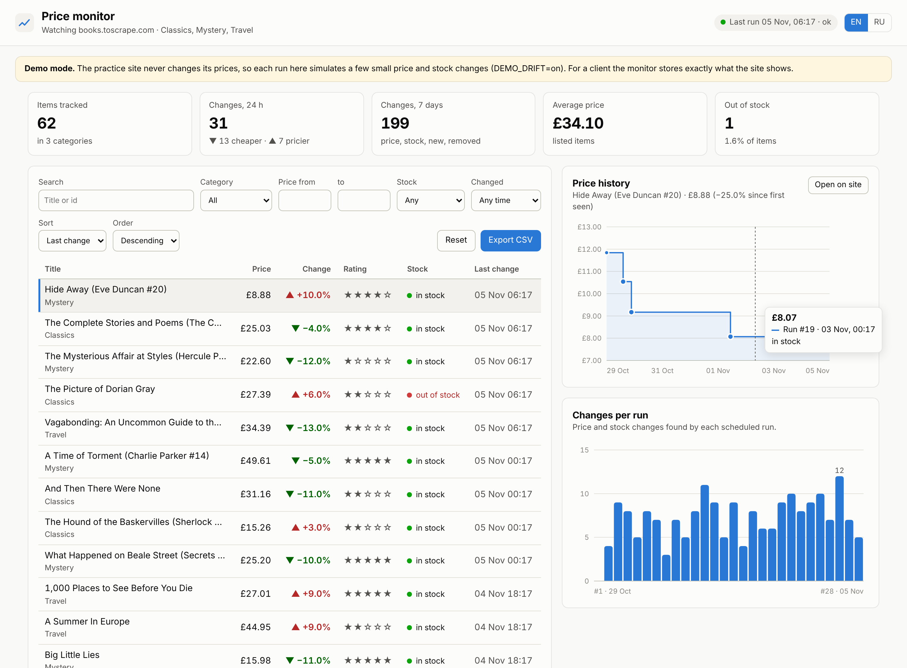
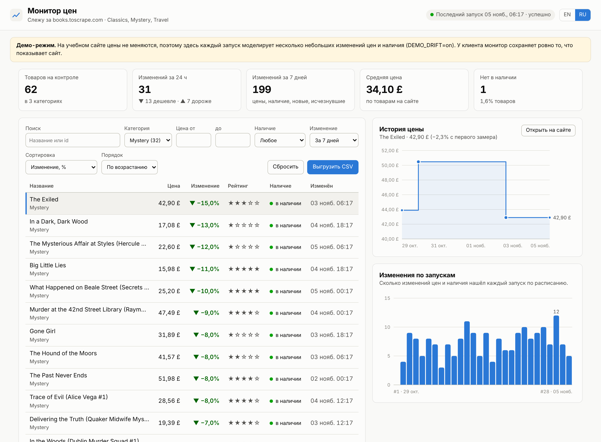
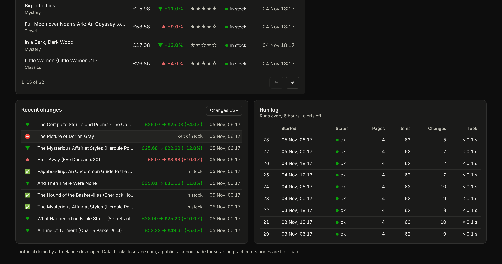

# Price monitor demo (scraper + dashboard)

A price and listing monitor that runs on Cloudflare's free plan. It refreshes itself: a visit to the dashboard starts a scrape of the watched
categories when the last one is more than 6 hours old, stores a snapshot in D1 and works out what changed: price up or down, out of stock, back in stock,
new listing, listing removed. It sends a Telegram alert about the changes (optional) and shows everything on a
dashboard with tables, filters, a price chart and CSV export. The interface is in English and Russian.

The target is **books.toscrape.com**, a public sandbox built for scraping practice. It is not a real shop and its
prices are fictional. Point it at a real site only with the owner's permission, or where the site's terms and
robots.txt allow it.

| Overview (EN) | Filters + price history (RU) | Changes + run log (dark) |
|---|---|---|
|  |  |  |

The screenshots come from a headless run of the real Worker API: 28 six-hourly runs over the saved pages in
`test/fixtures`, with demo drift on (`npm run shots`).

## What it does

- **Lazy scheduled scraping (no cron trigger):** when the dashboard or `/api/summary` is requested and the last run is
  older than `REFRESH_HOURS` (6), the Worker starts a run in `ctx.waitUntil`. A row in the D1 table `meta` is the lock,
  so two visitors never start two runs. The crawler follows pagination and caps the
  run at `MAX_PAGES`, and a 15 s timeout applies to each page. It identifies itself with a polite User-Agent.
- **History in D1:** `items` holds the latest state, `snapshots` one row per item per run, and `changes` the diff.
  Every write of a run goes in one batch of 8 statements, whatever the item count, so the free plan's
  50-queries-per-run limit is never close.
- **Safe failure handling:**
  - If a page fails or the layout changes ("no products found"), the run is marked `partial` or `error`.
  - Items in a category that was not fully checked are never marked "removed".
  - You get a Telegram message saying what was not checked.
- **Dashboard (`/`):**
  - Summary tiles.
  - Item table with search, category, price range, stock, "changed in the last N days", sorting and paging.
  - Price history step chart with hover details.
  - Changes-per-run bar chart, recent-changes feed and run log.
  - EN/RU switch and light/dark theme.
  - The URL keeps the filters, so a filtered view can be shared.
- **CSV export:** items with the current filters, or the change log. UTF-8 with BOM so Excel opens it correctly,
  and protected against formula injection.
- **Telegram alert (optional):** biggest price moves first, then stock, new, back and removed.
  - RU or EN text.
  - `MIN_CHANGE_PCT` filters out small moves.
  - Link to the dashboard.
  - The first run sends "monitoring started, N items" instead of a 62-line list.
- **Manual run:** `POST /api/run` with `Authorization: Bearer <ADMIN_KEY>`.
- **Demo mode** (`DEMO_DRIFT = "on"`): the practice site never changes its prices, so each run moves about 8 %
  of prices by 3-15 % and sells out or restocks a few items.
  - It is deterministic and stays within 60-140 % of the scraped price.
  - It is labelled on the dashboard and in every alert.
  - Set it to `"off"` and the stored values are exactly what the site shows.

Sample alert from the test run (EN; the default is RU):

```
📊 Price monitor: 5 changes (run #2)

🔻 It's Only the Himalayas: £45.17 → £39.99 (−11.5%)
🔺 Emma: £32.93 → £35.00 (+6.3%)
⛔ Gone Girl: out of stock
🆕 The New Mystery — £47.82 (new)
🗑 The Great Railway Bazaar: removed from the site

Open the dashboard
```

## Files

| Path | What |
|---|---|
| `src/lazy.js` | Lazy refresh: due check plus the D1 lock |
| `src/worker.js` | Worker entry: `fetch` (`/api/*`, everything else is static assets) |
| `src/parse.js` | HTML parser for the listing pages (regex over each `article.product_pod`, no DOM needed) |
| `src/monitor.js` | One run: crawl, diff, one D1 batch, alert |
| `src/drift.js` | Demo-mode price/stock simulation |
| `src/alert.js` | Telegram text (RU/EN) and sending |
| `src/api.js` | `/api/summary`, `/api/items`, `/api/history`, `/api/changes`, `/api/runs`, `/api/export.csv`, `POST /api/run` |
| `public/` | Dashboard: `index.html`, `app.js` (plain JS, SVG charts, no CDN), `style.css` |
| `migrations/0001_init.sql` | D1 schema |
| `test/` | Offline tests, saved HTML pages, a D1 stand-in on `node:sqlite` |
| `scripts/deploy.mjs` | One-command deploy |
| `scripts/local.mjs` | Offline preview server (`npm run demo`) |
| `scripts/shots.mjs` | Screenshots (`npm run shots`, needs Playwright) |
| `scripts/fetch-fixtures.mjs` | Re-download the saved pages from the live site (`npm run fixtures`) |

## Run it offline

Needs Node 22.13 or newer (it uses the built-in `node:sqlite`). No internet and no Cloudflare account needed.

```bash
cd demos/scraper-dashboard && npm test
```

26 tests cover:
- the parser: products, pagination, entities, out of stock, broken pages;
- the monitor: baseline, every change type, failed category, broken layout, `MAX_PAGES`, demo drift, retention;
- alerts: text, plurals, threshold, sending;
- the API: filters, sorting, history, feeds, CSV, admin key, routing.

They run against the saved pages in `test/fixtures` and an in-memory database. See `test/fixtures/README.md` for
how the saved pages were made.

To look at the dashboard without deploying (a week of seeded runs):

```bash
cd demos/scraper-dashboard && npm run demo
```

Then open http://127.0.0.1:8787 (Russian: http://127.0.0.1:8787/?lang=ru).

To run the Worker itself locally (wrangler + local D1; scrapes the live site):

```bash
cd demos/scraper-dashboard && npm install && npm run db:local && npm run dev
```

Open the dashboard once and the lazy refresh starts a run if the data is older than 6 hours. To force one:
`curl -X POST -H "Authorization: Bearer <ADMIN_KEY>" <url>/api/run`.

## Deploy (one command)

Once: install Node 22.13+, then run `npx wrangler login` (a free Cloudflare account is enough).

```bash
cd demos/scraper-dashboard && npm install && npm run deploy
```

What it does:
1. Creates the D1 database (first run only) and writes its id into `wrangler.toml`.
2. Applies the migration.
3. Deploys the Worker, the dashboard and to `*.workers.dev`, and writes that URL into `PUBLIC_URL`.
4. Stores a random `ADMIN_KEY` secret (also saved to `admin-key.txt`, which git ignores).
5. Starts the first scrape right away, so the dashboard has data before the first lazy refresh.

At the end it prints the dashboard URL. `node scripts/deploy.mjs --dry` prints the steps without changing anything.
If `wrangler d1 create` asks whether to add the database to the config, answer **No**: the script writes the id
itself.

After changing `wrangler.toml` later, redeploy with plain `npx wrangler deploy`.

**Telegram alerts (optional):**
1. Create a bot in @BotFather and paste its token into `bot-token.txt` in this folder (one line; git ignores it).
2. Write `/start` to the bot.
3. Run `npm run deploy` again. It stores `BOT_TOKEN` and `TG_CHAT_ID` as secrets. To use another chat (a group,
   for example), pass `--chat <id>`.

Without a token everything works except the messages.

### Settings (`wrangler.toml` → `[vars]`)

| Variable | Default | Meaning |
|---|---|---|
| `SOURCE_URL` | `https://books.toscrape.com/` | Site root |
| `CATEGORIES` | `travel_2,mystery_3,classics_6` | Category slugs from the site's sidebar links (62 books, 4 pages) |
| `MAX_PAGES` | `20` | Page cap per run |
| `DEMO_DRIFT` | `on` | Simulated changes for the static practice site; `off` for real data |
| `ALERT_LANG` | `ru` | Alert language, `ru` or `en` |
| `MIN_CHANGE_PCT` | `0` | Do not alert on price moves smaller than this (they are still stored) |
| `RETAIN_DAYS` | `90` | History older than this is deleted on each run |
| `REFRESH_HOURS` | `6` | A visit starts a new run when the last one is older than this |
| `PUBLIC_URL` | written by deploy | Dashboard link in alerts |

The secrets `ADMIN_KEY`, `BOT_TOKEN` and `TG_CHAT_ID` are set by the deploy script (`npx wrangler secret put <NAME>`).

### Free plan limits worth knowing

- **Outgoing requests:** the free plan allows 50 per invocation, so `MAX_PAGES` stays below that (20 by default).
- **Cron triggers:** 5 per account, so this demo uses none (lazy refresh instead).
- **CPU time:** parsing the 4 saved pages takes about 0.5 ms; the free plan's limit is 10 ms per invocation.
  Live pages are about twice as large. Watching hundreds of pages would need the paid plan ($5 a month) or
  several Workers.
- **D1 storage:** 5 GB. At 62 items × 4 runs a day × 90 days that is about 22,000 snapshot rows, a few MB.

## Reusing it for a client

1. Write a parser for their site with the same output shape (`src/parse.js` documents it). The crawler, storage,
   diff, alerts and dashboard stay as they are.
2. Set `DEMO_DRIFT = "off"`, `CATEGORIES` / `SOURCE_URL`, `REFRESH_HOURS` and `ALERT_LANG`.
3. Save two or three of their pages as fixtures and adapt the parser tests.

Sites that render with JavaScript or block bots need a headless browser (Cloudflare Browser Rendering) or the
site's API, which is a separate quote.

---

## Для заказчика (RU)

**Что это.** Монитор цен и товаров на сайте. По расписанию (например, каждые 6 часов) он обходит нужные разделы
и сохраняет снимок: цена, наличие, рейтинг. Он сам находит изменения: подешевело, подорожало, закончилось,
снова появилось, новый товар, товар исчез. В Telegram приходит короткое сообщение со списком изменений, самые
крупные сверху. Вся история видна на веб-дашборде.

**Что есть в демо:**
- таблица товаров с поиском и фильтрами: категория, цена от/до, наличие, «менялись за 24 ч / 7 / 30 дней»,
  сортировка по изменению в %;
- график истории цены по каждому товару;
- лента изменений и журнал запусков: видно, что монитор работает и сколько нашёл;
- выгрузка в CSV (с учётом фильтров), открывается в Excel без «кракозябр»;
- уведомления в Telegram на русском или английском, с порогом: например, не писать про изменения меньше 3 %;
- интерфейс на русском и английском, светлая и тёмная тема.

**Надёжность.** Если сайт не ответил или поменял вёрстку, запуск помечается как ошибочный, и приходит
сообщение «не проверено». Товары при этом не считаются исчезнувшими, так что ложных тревог нет.

**Демо-данные.** Демо работает на books.toscrape.com, учебном сайте для практики парсинга (цены там вымышленные
и не меняются). Поэтому в демо-режиме изменения моделируются, и это явно подписано. На вашем сайте монитор
сохраняет ровно то, что на нём написано.

**Стоимость работы.** Всё работает на бесплатном тарифе Cloudflare (Workers + D1): сервер арендовать не
нужно, и платных ключей тоже нет. Данные хранятся в вашем аккаунте Cloudflare.

**Что нужно от вас:**
- ссылки на разделы или товары, которые отслеживать;
- как часто проверять;
- куда слать уведомления (вы, группа или канал);
- подтверждение, что сбор данных с этого сайта разрешён: свой сайт, сайт партнёра или открытые данные с
  разрешением в правилах сайта.

**Что вы получите:**
- рабочий монитор на вашем аккаунте;
- код и тесты;
- инструкцию «как добавить раздел» и одну команду для повторного развёртывания.
