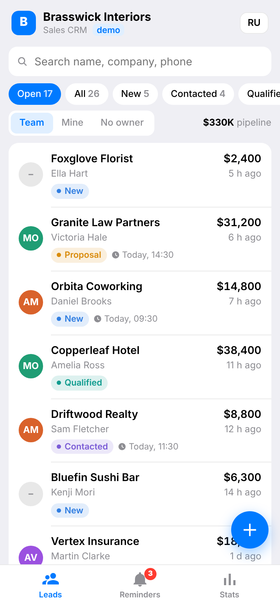
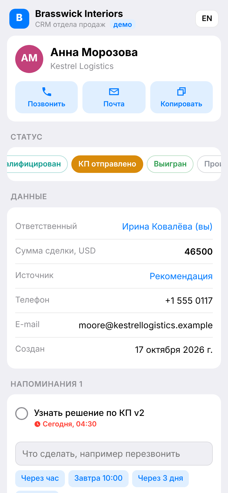
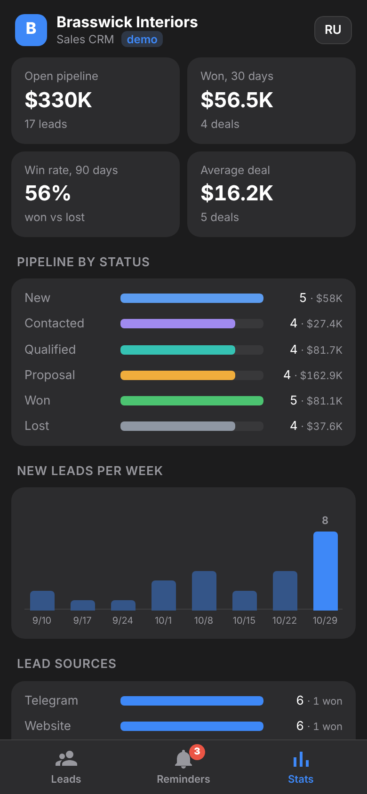

# Telegram Mini App CRM for a small sales team

A sales CRM that lives inside Telegram: a **Mini App** for leads and a **bot** that sends a morning digest and
reminder pings. Built for the sales team of **Brasswick Interiors**, a fictional office fit-out company; every company,
person, phone and e-mail in the seed data is made up.

**Live demo (no Telegram needed): https://tg-crm-miniapp-demo.sherlock753cc.workers.dev/**
Open it on a phone or a laptop and click through your own private sandbox of fictional data (EN / RU). In Telegram the
same app opens as a Mini App inside the chat; the bot is not connected to this public demo yet.
Built by Ilshat, Telegram @shov69, https://ilshat-builds.sherlock753cc.workers.dev/

Runs free on Cloudflare: one Worker serves the Mini App (static HTML/JS), the JSON API and the bot webhook; data is in
D1. No cron trigger, no paid APIs, no build step, no frontend framework.

| Leads list | Lead card (RU) | Stats (dark theme) |
|---|---|---|
|  |  |  |

Screenshots are rendered from a headless run of the real app on seeded data (`npm run shots`).

## What it does

**Mini App**
- **Leads**: search by name, company, phone or e-mail (Cyrillic works too); filter chips by status with counts
  (Open, All, New, Contacted, Qualified, Proposal, Won, Lost, Overdue); Team / Mine / No owner switch; open pipeline total.
- **Lead card**: call / e-mail / copy buttons; one-tap status change; owner, deal size and source editing; reminders with
  quick presets (in 1 hour, tomorrow 10:00, in 3 days, Monday); notes and a history timeline (status and owner changes
  are logged automatically).
- **New lead** form.
- **Reminders**: overdue / today / upcoming, mine or the whole team, tick to close; a badge on the tab shows what is due.
  "Send me today's digest" button.
- **Stats**: open pipeline, won in the last 30 days, 90-day win rate, average deal; pipeline by status, new leads per week
  (8 weeks), lead sources, team table (open leads and wins per person).
- Follows the Telegram theme (light or dark), haptic feedback, native Back button. English and Russian, switchable.

**Bot** (optional: needs a bot token, not part of the public browser demo)
- `/start` with an "Open CRM" button; the chat menu button also opens the Mini App.
- **Daily digest** at 9:00 in each person's own local time: reminders due today, overdue, new leads assigned to you,
  unassigned leads, leads with no activity for 7+ days, team pipeline, wins this week.
- **Reminder pings** when a reminder is due, with a button that opens that lead.
- `/digest`, `/today`, `/new Name, Company, Phone` (add a lead from the chat), `/lang`, `/invite` (team mode), `/reset` (demo).

**Security**
- Every API call carries Telegram `initData`; the Worker checks its HMAC-SHA256 signature with the bot token
  (`src/auth.js`, the algorithm from Telegram's docs), rejects stale sessions (24 h, `INIT_DATA_MAX_AGE`) and takes the user
  only from the signed data, never from the request body.
- Browser demo mode: a visitor without initData gets a random sandbox id in an HttpOnly, SameSite=Lax cookie signed
  with HMAC-SHA256 (`SESSION_SECRET`, `src/session.js`). A tampered or foreign cookie is ignored and the visitor gets a
  new sandbox, never somebody else's. Browser ids are negative numbers, so they can never equal a Telegram user id.
- Every query is scoped to the caller's workspace: a lead id from another team returns 404, an owner from another team 400.
- The webhook only accepts updates with the secret token set at `setWebhook`.

## Browser demo mode and free-tier limits

- No initData in the request (a normal browser), or no `BOT_TOKEN` configured: the Worker issues the signed sandbox cookie
  and seeds the same fictional data as in Telegram. A slim banner says so; on a wide screen the app is a centred 420 px
  column on a neutral background, full width on a phone. Valid initData (with `BOT_TOKEN` set) still takes the Telegram
  path unchanged; invalid initData is a 401. The app starts and logs no errors without a bot token.
- Per sandbox caps: 80 leads, 40 notes per lead, 80 reminders. New sandboxes: 8 per IP per hour and 300 per day in total
  (counters in the `demo_limits` D1 table). "Reset demo data" in the app restores the seed.
- Sandboxes older than 7 days are deleted lazily: each time a new sandbox is created, up to 10 expired ones are removed.
- No cron: reminders are computed when the app reads them (overdue / today / upcoming, the tab badge). In a browser the
  digest button shows a preview of the morning message the owner would get in Telegram instead of sending it.
  `runCron` in `src/bot.js` still exists for a bot deployment: add `[triggers] crons = ["*/15 * * * *"]` and a `scheduled`
  call (already exported by the Worker) to send reminder pings and the 9:00 digest.

## Two modes

- **Demo (`DEMO_MODE = "on"`, default)**: every visitor gets a private sandbox seeded with 26 fictional leads, a team of
  four (the visitor plus three colleagues), notes and reminders relative to "now", so the digest and overdue items always
  look alive. `/reset` restores the seed. Sandboxes older than 7 days are removed lazily (see above).
- **Team (`DEMO_MODE = "off"`)**: one shared workspace, starts empty. People listed in `ADMIN_IDS` get in as admins;
  an admin sends `/invite` and gets a `t.me/<bot>?start=join_<code>` link for colleagues (a new `/invite` revokes the old link).

## Deploy (one command)

Needs Node 22.13+ and a free Cloudflare account. **Browser demo only** (what is deployed publicly): create the D1 database
`tg-crm-miniapp-demo`, put its id in `wrangler.toml`, then

```bash
npx wrangler d1 migrations apply tg-crm-miniapp-demo --remote
npx wrangler secret put SESSION_SECRET      # any long random string
npx wrangler deploy
```

**With a Telegram bot**: first create a bot in [@BotFather](https://t.me/BotFather) and paste
its token into `bot-token.txt` in this folder (git-ignored). Then:

```bash
cd demos/tg-crm-miniapp && npm install && npm run deploy
```

On the first run wrangler opens a browser to log in to Cloudflare. The script creates the D1 database (and writes its
id into `wrangler.toml`), applies the migrations, deploys the Worker with the Mini App, stores the secrets
(`BOT_TOKEN`, `WEBHOOK_SECRET`, `APP_URL`, `BOT_USERNAME`), sets the webhook, the menu button, the commands and the bot
descriptions in EN and RU. It prints the bot link at the end. `npm run deploy -- --dry` shows every step without changing
anything.

After a code change, redeploy with:

```bash
npx wrangler deploy
```

For a real team: set `DEMO_MODE = "off"` and `ADMIN_IDS = "<your Telegram id>"` in `wrangler.toml`, then `npx wrangler deploy`.
`CURRENCY` (e.g. `"RUB"`, `"EUR"`) and `DIGEST_HOUR` are there too.

## Run and test locally (no Cloudflare, no Telegram)

```bash
npm test
```

39 offline tests (Node's built-in test runner, ~0.3 s): initData validation against an independent `node:crypto`
signer (tampered user, wrong bot, expired, future, malformed), the whole API (auth, sandbox seeding, filters,
Cyrillic search, lead card, notes, reminders, stats, workspace isolation, team mode and invites), bot commands,
webhook secret, reminder pings sent exactly once, the digest timing per local time, and the browser demo mode (valid
cookie, tampered and foreign cookies rejected, no initData gives a sandbox, row caps, per-IP limit, 7-day cleanup). They run the real Worker
code on an in-memory SQLite that implements the D1 API (`scripts/d1-sqlite.mjs`), so nothing needs installing.

```bash
npm run preview
```

Opens the real Worker on http://127.0.0.1:8788 in browser demo mode; messages the
bot would send are printed in the terminal. `npm run dev` runs it on `wrangler dev` with local D1 instead
(apply migrations with `npx wrangler d1 migrations apply tg-crm-miniapp-demo --local` and put `BOT_TOKEN` in `.dev.vars`).
`npm run shots` re-renders the screenshots (needs Playwright with Chromium).

## Files

| Path | What |
|---|---|
| `src/worker.js` | Entry: routes `/api/*`, `/webhook`, static Mini App, `scheduled()` (only used with a cron) |
| `src/session.js` | Browser demo sessions: signed sandbox cookie |
| `src/auth.js` | Telegram initData validation (WebCrypto) |
| `src/api.js` | JSON API for the Mini App |
| `src/crm.js` | D1 queries: membership, leads, timeline, reminders, stats, digest |
| `src/bot.js` | Bot commands, reminder pings, daily digest |
| `src/seed.js` | Fictional demo data (EN and RU) |
| `src/i18n.js` | Statuses, sources, bot copy in EN and RU |
| `public/` | The Mini App: `index.html`, `app.js`, `app.css` |
| `migrations/` | D1 schema (`0001_init.sql`) and demo limit counters (`0002_demo_limits.sql`) |
| `scripts/deploy.mjs` | One-command deploy and Telegram setup |
| `scripts/preview.mjs`, `scripts/d1-sqlite.mjs` | Local preview and the SQLite D1 stand-in used by tests |
| `scripts/shots.mjs` | Headless screenshots |
| `test/` | Offline tests |

---

## По-русски: для заказчика

**CRM отдела продаж прямо в Telegram.** Менеджеры не ставят новых программ и не заводят логины: открывают бота,
жмут «Открыть CRM» — и работают с лидами в мини-приложении. В Telegram вход автоматический, подпись проверяется на сервере; для просмотра в браузере есть публичное демо.

Что есть в демо:
- **Список лидов** с поиском, фильтрами по статусу (Новый → Связались → Квалифицирован → КП отправлено → Выигран / Проигран),
  по ответственному («Мои», «Команда», «Без ответственного») и по просроченным задачам; сумма открытой воронки.
- **Карточка лида**: позвонить / написать в один тап, смена статуса, ответственный, сумма сделки, источник,
  заметки и история изменений, напоминания с быстрыми кнопками «Через час», «Завтра 10:00», «Через 3 дня».
- **Напоминания**: просроченные, на сегодня, позже; свои или всей команды.
- **Утренняя сводка от бота** в 9:00 по времени каждого менеджера: что сделать сегодня, что просрочено, новые лиды,
  лиды без ответственного, «заснувшие» лиды, воронка команды, выигрыши за неделю.
- **Бот пишет, когда подходит срок напоминания**, с кнопкой сразу в карточку лида. Лида можно добавить прямо из чата: `/new Имя, Компания, Телефон`.
- **Статистика**: воронка, конверсия, средний чек, новые лиды по неделям, источники, показатели по каждому менеджеру.
- Русский и английский интерфейс, светлая и тёмная тема Telegram.

Как попробовать: откройте демо в браузере (ссылка вверху), без регистрации, или бота демо в Telegram — у вас будет своя песочница с вымышленными данными компании
Brasswick Interiors (компания и все контакты выдуманы). Можно менять статусы, добавлять лиды и заметки — другим
посетителям это не видно. Кнопка «Сбросить демо-данные» (в Telegram `/reset`) возвращает исходные данные. Песочницы старше 7 дней удаляются.

Что можно доработать под ваш бизнес:
- свои этапы воронки, поля карточки (бюджет, город, тип объекта…), источники лидов;
- приём заявок с сайта, из формы или из другого бота сразу в CRM; уведомление ответственному;
- выгрузка в Google Таблицы / Excel, интеграция с amoCRM / Bitrix24 или вашим API;
- роли (руководитель видит всех, менеджер — своих), распределение лидов по очереди;
- отчёт руководителю в чат раз в день или неделю.

Техника: Cloudflare Workers + D1 — хостинг бесплатный на малых объёмах, сервер не нужен, разворачивается одной командой.
Код ваш, с тестами и инструкцией.
