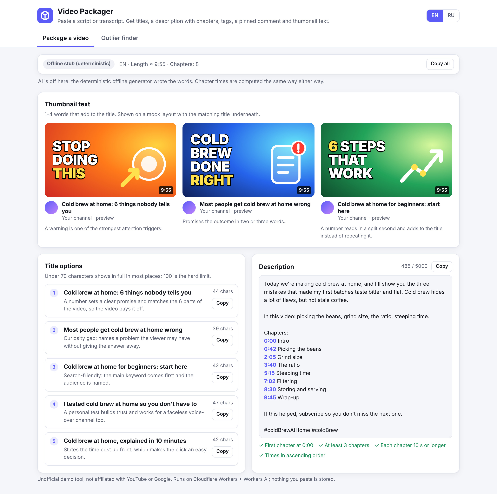
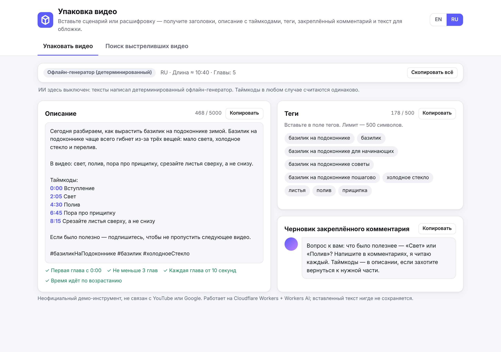
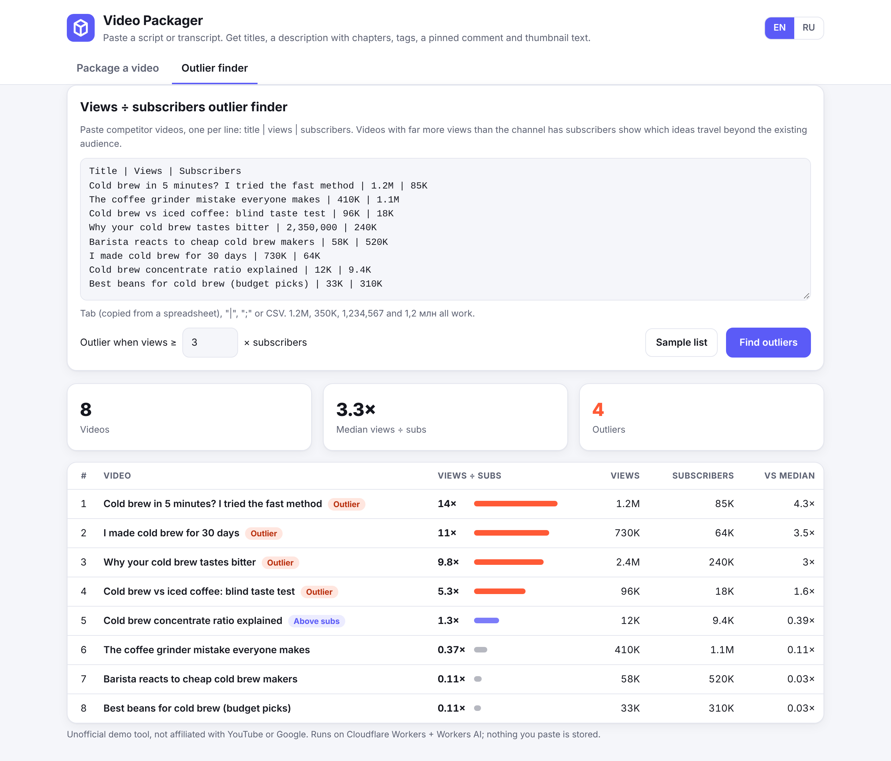

# Video Packager: titles, chapters, tags and thumbnail text from a transcript (demo)

A small web tool for YouTube channel owners. Paste a video script or transcript (or open an `.srt` / `.vtt`
file) and get:

- **5 title options**, each with a one-line reason (number, curiosity, search keyword first, personal test, time
  promise), with a character counter (70 soft / 100 hard limit);
- **a description** with a hook, a short "in this video" line, **chapters computed from the timestamps** in the
  text, a subscribe line and 3 hashtags; a checklist shows YouTube's chapter rules (first at 0:00, at least 3,
  each 10 s or longer, ascending);
- **tags** that fit the 500-character tag box;
- **a pinned-comment draft** that starts a discussion;
- **3 thumbnail texts** (1–4 word trigger phrases) shown on a mock thumbnail with the matching title under it;
- a separate **"views ÷ subscribers" outlier finder**: paste competitor videos (title | views | subscribers) and
  see which ones broke out far beyond their channel's size.

EN and RU interface (switch top right; the output language follows the transcript or is forced). Unofficial
demo, not affiliated with YouTube or Google; nothing pasted is stored.

| Titles, thumbnail mock, description (EN script) | Description with chapters from `.srt`, tags, pinned comment (RU) | Outlier finder |
|---|---|---|
|  |  |  |

The shots are a real headless run of this code in offline mode (`scripts/shots.mjs`), so the words come from the
deterministic offline generator, labelled as such on screen. The deployed version writes them with Workers AI.

## How it works

- **Stack:** one Cloudflare Worker with static assets (the page in `public/`) and one route, `POST /api/package`.
  Workers AI model `@cf/meta/llama-3.1-8b-instruct-fast` on the free daily allowance. No paid API keys, no
  secrets. A small D1 table only counts AI calls (see "AI caps").
- **Chapter times never come from the AI.** `public/lib/chapters.js` reads the timestamps (`0:42 Heading` lines,
  `[01:15]`, `Heading — 12:30`, YouTube "Show transcript" copy, SRT, WebVTT), groups dense subtitle cues into
  ~2-minute chapters (cutting where a new topic starts: "Now…", "Next…", "Теперь…", "Дальше…"), and enforces the
  rules (0:00 start, ≥3 chapters, ≥10 s each, ascending; videos over an hour use `h:mm:ss`). The AI only names
  the chapters, and a time it slips into a name is stripped.
- **AI with a safety net.** The model gets the keyword, the chapter list and up to 6,000 characters of the
  transcript, and must answer in JSON. Every field is validated (5 titles under 100 chars with reasons, 3
  thumbnail texts of ≤4 words, tags within 500 chars, chapter names matching the chapter count). A bad field is
  replaced by the offline generator's field; if the AI fails or is out of allowance, the offline generator answers
  everything, and the page says which one wrote the words.
- **Reuse of AI answers:** an identical input (a visitor re-running a built-in sample, a double click) is answered
  from the memory of the running Worker instance instead of a new AI call. On a custom domain the Cache API also
  keeps answers for a day; on `*.workers.dev` Cloudflare's Cache API does nothing, so there it is memory only
  (a fresh instance asks the AI again).
- **Outlier finder** runs entirely in the browser (`public/lib/outliers.js`): it reads `1.2M`, `350K`, `1,234,567`,
  `1 234 567`, `1,2 млн`, `350 тыс`; tab (spreadsheet copy), `|`, `;` or CSV; skips a header line; reports lines it
  cannot read. Ratio = views ÷ subscribers; flagged as an outlier at ≥3× (adjustable); also shows each video
  against the list's median.

Files: `src/worker.js` (routes, cache), `src/package.js` (prompt, validation, offline generator, description),
`public/lib/chapters.js`, `public/lib/outliers.js`, `public/lib/text.js` (shared by Worker and page),
`public/index.html`, `public/app.js`, `public/i18n.js` (all EN/RU texts), `public/style.css`,
`public/samples/` (fictional sample script, subtitles and competitor lists), `test/` (offline tests),
`scripts/serve.mjs` (offline local server), `scripts/shots.mjs` (screenshots), `wrangler.jsonc`.

## Test (offline, no install)

```bash
npm test
```

40 tests with Node's built-in test runner, no dependencies, no network: chapter parsing and rules for every input
format, the outlier maths and number formats, the offline generator (deterministic, EN and RU), the AI path with a
fake Workers AI binding (good answer, fenced answer, partly bad answer, refused JSON mode, outage, AI switched off),
the Worker routes and errors, answer reuse (memory and Cache API), EN/RU text completeness, and a privacy scan.

Try it locally without a Cloudflare login (offline generator, same Worker code):

```bash
npm start
```

Then open http://127.0.0.1:8788. With the real AI locally: `npx wrangler dev` (uses your wrangler login; the AI
binding runs remotely and uses a little of the free allowance).

## Deploy

```bash
npx wrangler deploy
```

Needs a wrangler login with Workers, D1 and AI access. First create the small D1 database used only for the AI
caps (`npx wrangler d1 create video-packager-demo`, put its id into `wrangler.jsonc`) and apply the migration
(`npx wrangler d1 migrations apply video-packager-demo --remote`). Live demo:
`https://video-packager-demo.sherlock753cc.workers.dev`. No secrets.

Settings in `wrangler.jsonc` → `vars`:
- `AI_ENABLED = "off"`: never call the AI (offline generator only, zero AI usage);
- `AI_MODEL`: any Workers AI text model; a smaller one such as `@cf/meta/llama-3.1-8b-instruct-fp8` gives more free
  runs at lower quality (not tested with this prompt).

To re-shoot the screenshots (Playwright is not a project dependency):

```bash
npm i --no-save playwright && npx playwright install chromium && node scripts/shots.mjs
```

## AI caps (the demo is public and the allowance is free, so it is rationed)

- 5 AI runs per hour per visitor (a salted hash of the IP, never the IP itself) and 60 AI runs per day for everyone,
  counted in D1 (`migrations/0001_ai_usage.sql`). Past either cap the offline generator answers and the page says so.
  Repeated identical input is answered from memory and does not count. Without a D1 binding the AI is off.
- Model: `@cf/meta/llama-3.1-8b-instruct-fast`. The Workers Rate Limiting binding was not used: its period can only
  be 10 or 60 seconds, so it cannot express "per hour".
- The result badge shows whether the words came from Workers AI or from the offline generator.
- The form opens pre-filled with a made-up coffee channel script, and the outlier finder opens on demo data (made-up
  videos and channels, labelled as such).

## Limits worth knowing

- Workers AI free allowance: 10,000 neurons a day per account. One packaging sends about 1,000–2,500 input tokens
  and gets 500–1,000 back, roughly 130–270 neurons with the 70B model; the demo uses the smaller 8B model and caps itself at 60 runs a day. This is an
  estimate from the token counts and the model's published neuron rate, not a measurement. Past it, the offline
  generator answers and the page says so; repeated identical inputs are reused (see above).
- The offline generator is template-based: correct structure, real keyword, real chapter names, but generic angles.
  The AI version reads the transcript and is specific. Chapter times are identical in both.
- Chapter grouping for dense subtitles is by time with topic cues; a human may still want to move a cut by a few
  seconds. Long transcripts are cut to 6,000 characters for the AI (chapter starts are always sent).
- The outlier finder uses the numbers you paste; it does not fetch YouTube data (that needs a YouTube Data API key,
  a possible client add-on).

## For a buyer (EN)

**What you get:** a private packaging tool for your channel. Paste the script before recording or the transcript
after editing, and in under a minute you have five titles to A/B test, a description with chapters that already
follow YouTube's chapter rules, tags, a pinned comment and thumbnail text your designer can use. The outlier finder
shows which competitor topics travelled far beyond their audience, so you pick ideas with proof.

**Adapted to you:** your channel's tone and banned words in the prompt; your own description template (links,
sponsors, socials); more languages; your niche's title formulas; a button that sends results to Google Sheets or
Notion; competitor stats pulled automatically from the YouTube Data API; a team login. Runs on your own
Cloudflare account, free tier included.

## Для заказчика (RU)

**Что это.** Инструмент упаковки видео для вашего канала. Вставляете сценарий до записи или расшифровку после
монтажа — и меньше чем за минуту получаете 5 вариантов заголовка с объяснением, почему каждый работает; описание
с таймкодами, которые уже соответствуют правилам YouTube для глав (проверка встроена); теги в пределах лимита;
черновик закреплённого комментария; 3 варианта текста для обложки, сразу на макете превью. Второй экран —
поиск «выстреливших» видео у конкурентов: вставляете список «название | просмотры | подписчики», и видно, какие
темы набрали в разы больше просмотров, чем у канала подписчиков. Это темы с доказанным спросом.

**Почему это экономит деньги.** Упаковка — то, за что каналы без лица и студии платят отдельно и каждую неделю.
Инструмент делает черновик за минуту; редактор правит, а не пишет с нуля. Таймкоды считаются из реальных меток
времени, а не придумываются нейросетью, поэтому ошибок в них нет.

**Как подстраивается под вас.** Тон и стоп-слова канала в промпте; ваш шаблон описания (ссылки, спонсоры,
соцсети); формулы заголовков для вашей ниши; дополнительные языки; выгрузка в Google Таблицы или Notion;
автоматический сбор статистики конкурентов через YouTube Data API; доступ для команды по паролю. Работает на
вашем аккаунте Cloudflare, бесплатного тарифа хватает на десятки упаковок в день, без платных ключей.
